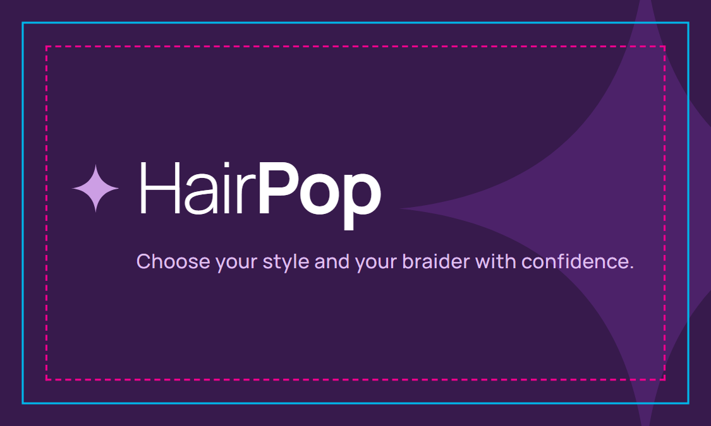
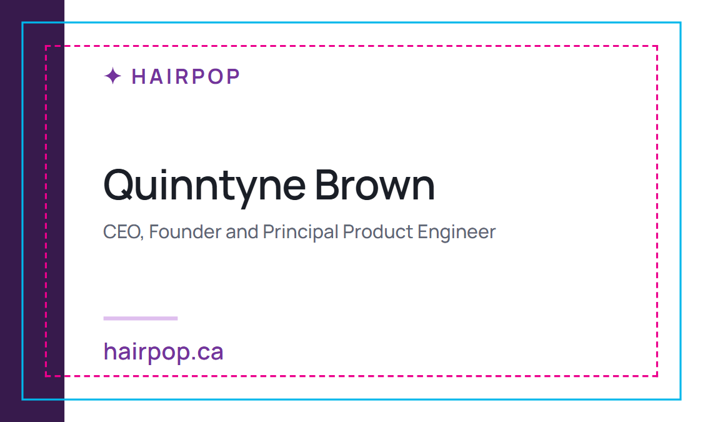

# HairPop business cards

Business card for **Quinntyne Brown**, CEO, Founder and Principal Product Engineer, [hairpop.ca](https://hairpop.ca).

| Front | Back |
|---|---|
|  |  |

Proofs show the trim line (solid cyan) and the safe area (dashed magenta). The guides are not in the print files.

## Files to send to the printer

| File | Use it for |
|---|---|
| [`dist/hairpop-business-card-quinntyne-brown.pdf`](dist/hairpop-business-card-quinntyne-brown.pdf) | Online and press printers (Vistaprint, Moo, Staples, local offset). Page 1 is the front, page 2 is the back. Each page is the full bleed size with no marks. |
| [`dist/hairpop-business-card-quinntyne-brown-crop-marks.pdf`](dist/hairpop-business-card-quinntyne-brown-crop-marks.pdf) | Printers who trim by hand or ask for crop marks. The same art on a 4.5 × 3 in sheet with crop marks outside the bleed. |
| `dist/*-proof.png` | 300 dpi previews for approval. Do not print these. |

## Print specification

| Setting | Value |
|---|---|
| Trim size | 3.5 × 2 in (88.9 × 50.8 mm), North American standard |
| Bleed | 0.125 in (3.175 mm) on every side, so each page is 3.75 × 2.25 in |
| Safe area | 0.125 in inside the trim; all copy sits inside it |
| Sides | Two-sided, front and back in the same orientation (landscape) |
| Artwork | Vector only: no raster images, so it is sharp at any resolution |
| Type | Manrope (SIL Open Font License), embedded as vector glyphs |
| Suggested stock | 16 pt (350 gsm) uncoated or matte, or 32 pt for a premium feel |

### Colour

The art uses the HairPop palette from [`docs/mocks/assets/tokens.css`](../mocks/assets/tokens.css). The PDF is RGB; the printer converts it to CMYK. Ask for a hard proof if colour is critical.

| Role | Token | RGB hex | Approximate CMYK |
|---|---|---|---|
| Front background, back band | `--palette-blue-900` | `#371A4C` | 75 / 100 / 30 / 45 |
| Front watermark | `--palette-blue-800` | `#4C2269` | 80 / 100 / 15 / 25 |
| Front sparkle | `--palette-blue-300` | `#CC9EE4` | 20 / 40 / 0 / 0 |
| Front tagline | `--palette-blue-200` | `#DFBFEE` | 12 / 25 / 0 / 0 |
| Back accent (brand, website) | `--palette-blue-600` | `#73349C` | 60 / 90 / 0 / 0 |
| Back name | `--palette-gray-900` | `#1A1E26` | 75 / 65 / 50 / 80 |
| Back title | `--palette-gray-600` | `#5E6675` | 60 / 45 / 35 / 15 |

The CMYK values are starting points for a printer who asks; their conversion should match the RGB swatches.

### Preflight notes

- Chromium writes Manrope (a variable font) as Type 3 vector glyphs. Most printers accept this. If a preflight tool rejects Type 3 fonts, open the PDF in Acrobat and convert text to outlines, or ask the printer to flatten it.
- The plum background and the back band extend into the bleed. Thin bands are kept at least 0.22 in wide inside the trim so normal cutting tolerance (±1/16 in) does not leave an uneven edge.

## Editing and regenerating

The card is built from [`business-card.html`](business-card.html). Open it in a browser to edit; add `?guides=1` to see trim and safe lines, or `?marks=1` to see the crop-mark sheet. Brand colours and type come from the mock tokens and fonts, so the card stays aligned with the product.

Regenerate all files from the repository root:

```powershell
python docs/business-cards/render.py
```

This needs Python Playwright with Chromium (`pip install playwright` and `playwright install chromium`).
