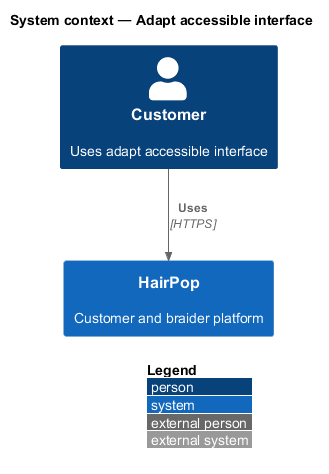
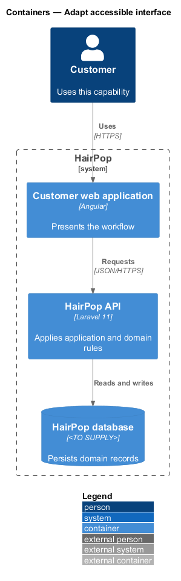
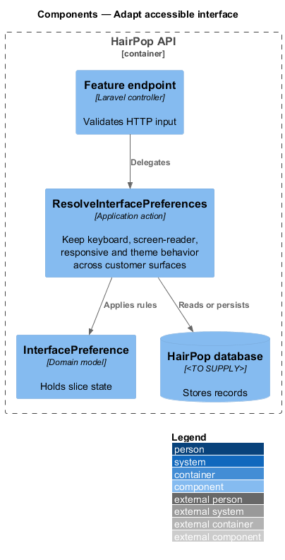
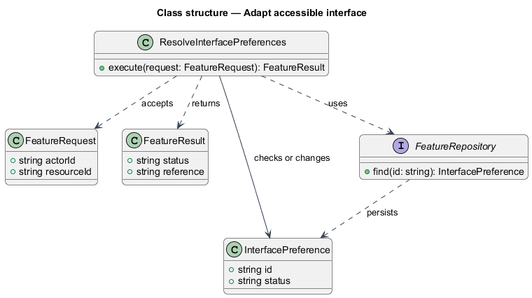
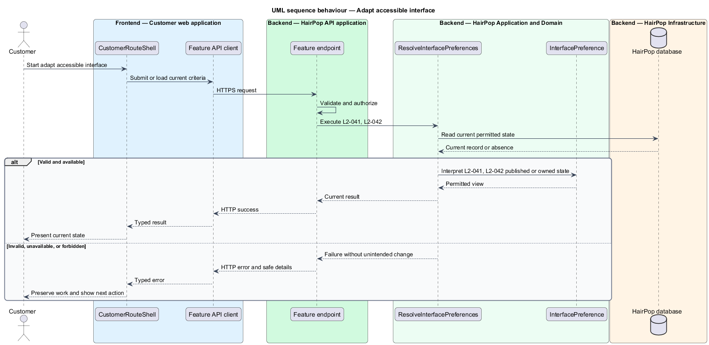

# Adapt accessible interface

## Overview

HairPop connects customers with braiders through published styles, service offerings, and appointment workflows. The accessibility subsystem supports this customer workflow. The `InterfacePreference` is the domain record that carries this slice's state. The slice addresses `L2-041`, `L2-042`. Its central behavior is to keep keyboard, screen-reader, responsive and theme behavior across customer surfaces.

## Description

`CustomerRouteShell` is the proposed Angular screen or dialog for this slice. It reads a typed API contract through an injection token and presents the states represented in the mocks. `ResolveInterfacePreferences` is the proposed Laravel application action. Its responsibility is to keep keyboard, screen-reader, responsive and theme behavior across customer surfaces. The API route and request and response schema are <TO SUPPLY>. A thin Laravel controller validates the request and delegates to the action. The `InterfacePreference` model holds the persisted state relevant to the action. Ownership and publication checks run before private fields are returned or changed. The repository persists or reads records through Laravel data access.

## Requirements

| L2 ID | Refines (L1) | Requirement |
|-------|--------------|-------------|
| `L2-041` | `L1-013` | Customer pages, dialogs, forms, notifications, and navigation must meet WCAG 2.2 AA behavior and retain the mock's accessible labels and state semantics. |
| `L2-042` | `L1-013` | Every customer-facing mock screen and dialog must remain usable at extra-small (<576 px), small (576–767 px), medium (768–991 px), large (992–1199 px), and extra-large (≥1200 px) widths, and in light and dark themes. |

## Diagrams

### System context

The customer uses HairPop for this capability. HairPop owns the state and publishes only the permitted result.

### Containers

The customer web application calls the Laravel API. The API reads or changes the HairPop database.

### Components

The API endpoint delegates to `ResolveInterfacePreferences`. The action applies the relevant rules around `InterfacePreference` and persistence.

### Class structure

`ResolveInterfacePreferences` receives a typed request, uses `InterfacePreference`, and returns a typed result.

### Behaviour

The sequence applies `L2-041`, `L2-042` while handling invalid or unavailable state without reporting success.

