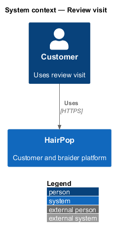
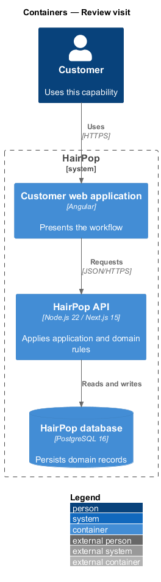
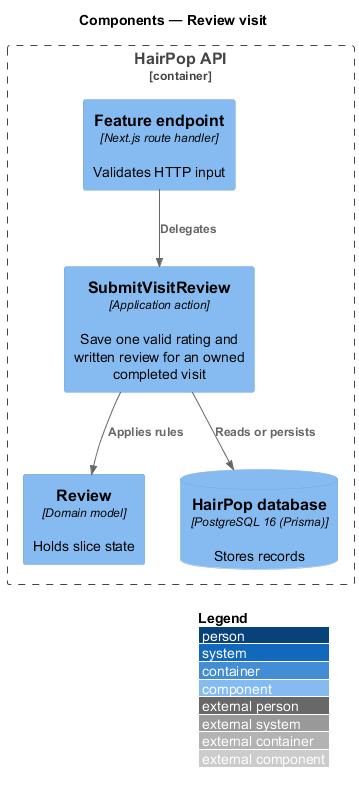
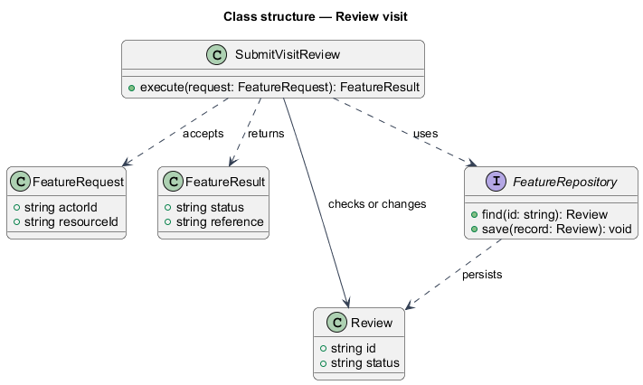
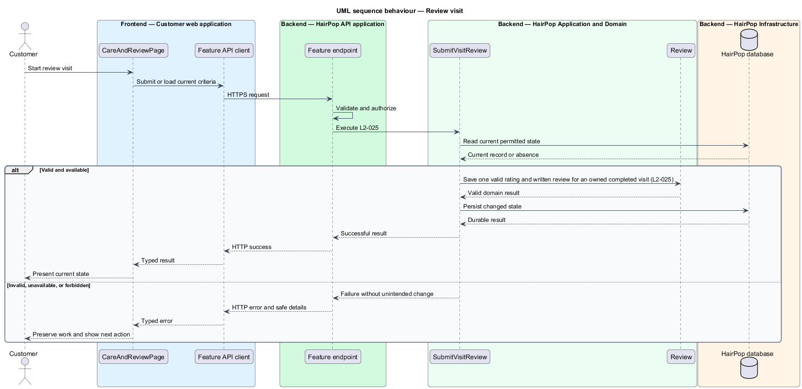

# Review visit

## Overview

HairPop connects customers with braiders through published styles, service offerings, and appointment workflows. The aftercare subsystem supports this customer workflow. The `Review` is the domain record that carries this slice's state. The slice addresses `L2-025`. Its central behavior is to save one valid rating and written review for an owned completed visit.

## Description

`CareAndReviewPage` is the proposed Angular screen or dialog for this slice. It reads a typed API contract through an injection token and presents the states represented in the mocks. `SubmitVisitReview` is the proposed application action in the Next.js API. Its responsibility is to save one valid rating and written review for an owned completed visit. The API contract for this slice is listed below. A thin Next.js route handler validates the request and delegates to the action. The `Review` model holds the persisted state relevant to the action. Ownership and publication checks run before private fields are returned or changed. The repository persists or reads records through Prisma.

**Frontend.** The rating is a horizontal radio group and the text a textarea; both keep their values after a failure (L2-025 AC5).

**Backend.** `SubmitVisitReview` stores one `Review` per appointment (unique `appointmentId`), tied to the visit's braider and service. A repeat with the attempt's `Idempotency-Key` — or a concurrent duplicate — answers 201 with the first review; a second review under another key is 409 `already_reviewed` (L2-025 AC4). Only a completed visit can be reviewed: anything else is 403 `not_completed`, and another customer's reference is 404 so the visit is not disclosed (L2-038 AC2). Text with a link, an email address or a phone number is saved as `pending` for moderation; other reviews publish at once and count in ratings (L2-008). Success records "Review posted" or "Review held for checks" (L2-029). Field errors are `errors.rating` and `errors.text` (1–1,000 characters after trimming).

| Part | Value |
|------|-------|
| Application | customer |
| Route | `/appointments/:ref/care` |
| Components | `CareAndReviewPage` |
| API token | `APPOINTMENTS_API` (`AppointmentsApi.submitReview`) |
| Render mode | Browser (signed in) |
| Mocks | `pages/care-and-review/*`, `notifications/review-feedback/*` |

**API contract.** All paths are relative to the API origin; JSON bodies; errors use `ApiErrorBody`.

| Method | Path | Access | Request | Success | Errors |
|--------|------|--------|---------|---------|--------|
| POST | `/api/appointments/{ref}/review` | customer (owner) | header `Idempotency-Key`; body `{ rating: 1–5; text: string (1–1000) }` | 201 `{ reviewId: string; status: 'published' \| 'pending' }` | 403 not completed or not owner; 409 `already_reviewed`; 422 `errors.rating`, `errors.text` |

## Requirements

| L2 ID | Refines (L1) | Requirement |
|-------|--------------|-------------|
| `L2-025` | `L1-007` | An owner must be able to submit one rating from 1 through 5 and a written review for a completed appointment; the review must remain associated with its braider and appointment. |

## Diagrams

### System context

The customer uses HairPop for this capability. HairPop owns the state and publishes only the permitted result.

### Containers

The customer web application calls the Next.js API. The API reads or changes the HairPop database.

### Components

The API endpoint delegates to `SubmitVisitReview`. The action applies the relevant rules around `Review` and persistence.

### Class structure

`SubmitVisitReview` receives a typed request, uses `Review`, and returns a typed result.

### Behaviour

The sequence applies `L2-025` while handling invalid or unavailable state without reporting success.

