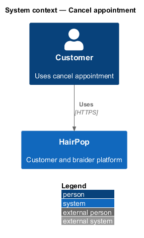
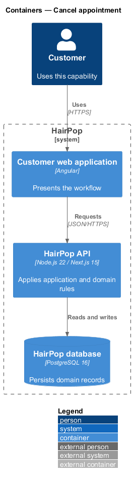
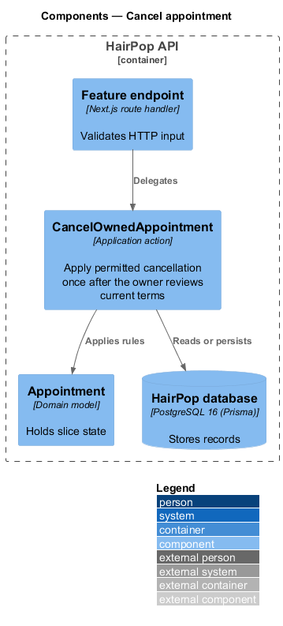
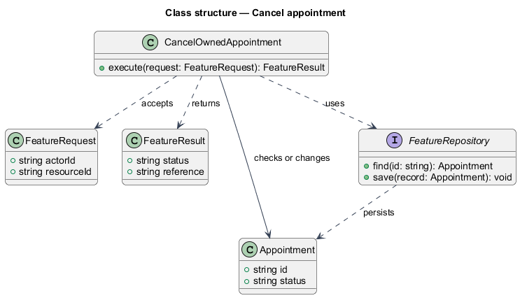
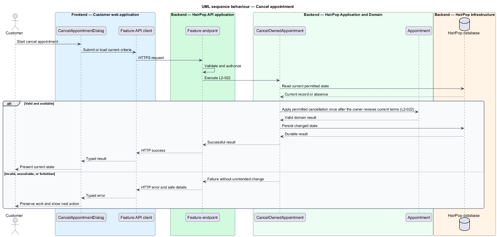

# Cancel appointment

## Overview

HairPop connects customers with braiders through published styles, service offerings, and appointment workflows. The appointments subsystem supports this customer workflow. The `Appointment` is the domain record that carries this slice's state. The slice addresses `L2-022`. Its central behavior is to apply permitted cancellation once after the owner reviews current terms.

## Description

`CancelAppointmentDialog` is the proposed Angular screen or dialog for this slice. It reads a typed API contract through an injection token and presents the states represented in the mocks. `CancelOwnedAppointment` is the proposed application action in the Next.js API. Its responsibility is to apply permitted cancellation once after the owner reviews current terms. The API contract for this slice is listed below. A thin Next.js route handler validates the request and delegates to the action. The `Appointment` model holds the persisted state relevant to the action. Ownership and publication checks run before private fields are returned or changed. The repository persists or reads records through Prisma.

**Frontend.** The destructive dialog shows the reference and current terms before confirmation; dismissing leaves the status unchanged (L2-022).

**Backend.** `CancelOwnedAppointment` cancels the owner's awaiting or confirmed item before its time with a conditional update, so a double submit cancels once and both calls answer 200 `{ status: 'cancelled' }`. It releases the slot and withdraws any pending change (releasing that slot too), and moves the `version` on, so the braider's view drops the request and an answer in flight is `stale`. A declined, completed or started item is 409 `not_cancellable`; another customer's reference is 404. Success records "Request cancelled" or "Appointment cancelled" (L2-029). The current terms the dialog shows come from the appointment detail's `policy`, the terms accepted at submission.

| Part | Value |
|------|-------|
| Application | customer |
| Route | dialog over `/appointments/:ref` |
| Components | `CancelAppointmentDialog` |
| API token | `APPOINTMENTS_API` (`AppointmentsApi.cancel`) |
| Render mode | Browser |
| Mocks | `dialogs/cancel-appointment/*` |

**API contract.** All paths are relative to the API origin; JSON bodies; errors use `ApiErrorBody`.

| Method | Path | Access | Request | Success | Errors |
|--------|------|--------|---------|---------|--------|
| POST | `/api/appointments/{ref}/cancellation` | customer (owner) | `{}` | 200 `{ status: 'cancelled' }` (repeat calls return the same) | 409 `not_cancellable`; 404 |

## Requirements

| L2 ID | Refines (L1) | Requirement |
|-------|--------------|-------------|
| `L2-022` | `L1-006` | An owner must be able to review the applicable cancellation terms and explicitly confirm cancellation where the current policy permits it. |

## Diagrams

### System context

The customer uses HairPop for this capability. HairPop owns the state and publishes only the permitted result.

### Containers

The customer web application calls the Next.js API. The API reads or changes the HairPop database.

### Components

The API endpoint delegates to `CancelOwnedAppointment`. The action applies the relevant rules around `Appointment` and persistence.

### Class structure

`CancelOwnedAppointment` receives a typed request, uses `Appointment`, and returns a typed result.

### Behaviour

The sequence applies `L2-022` while handling invalid or unavailable state without reporting success.

