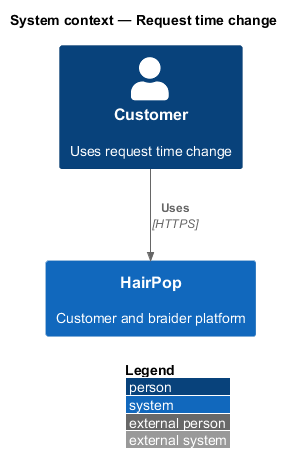
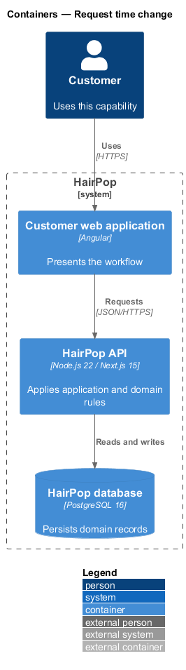
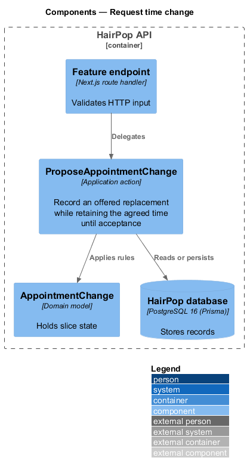
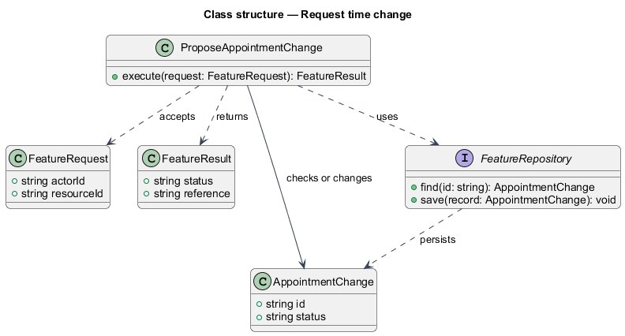
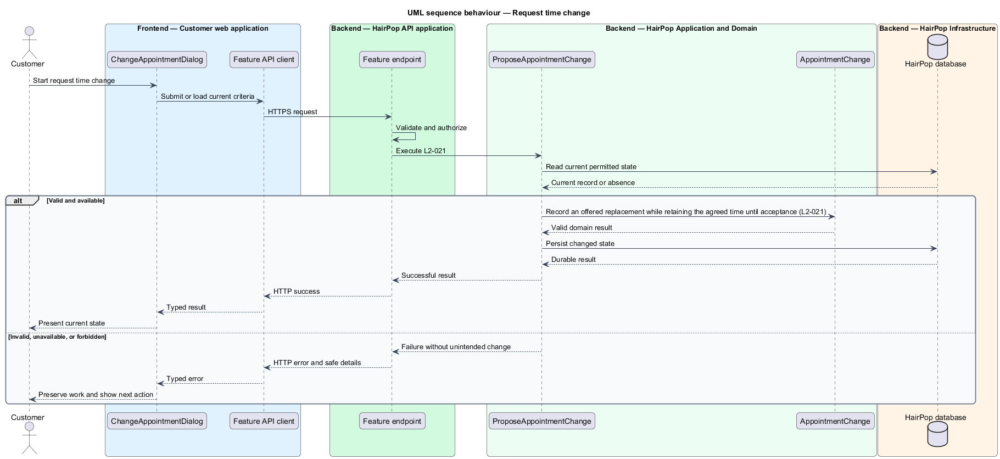

# Request time change

## Overview

HairPop connects customers with braiders through published styles, service offerings, and appointment workflows. The appointments subsystem supports this customer workflow. The `AppointmentChange` is the domain record that carries this slice's state. The slice addresses `L2-021`. Its central behavior is to record an offered replacement while retaining the agreed time until acceptance.

## Description

`ChangeAppointmentDialog` is the proposed Angular screen or dialog for this slice. It reads a typed API contract through an injection token and presents the states represented in the mocks. `ProposeAppointmentChange` is the proposed application action in the Next.js API. Its responsibility is to record an offered replacement while retaining the agreed time until acceptance. The API contract for this slice is listed below. A thin Next.js route handler validates the request and delegates to the action. The `AppointmentChange` model holds the persisted state relevant to the action. Ownership and publication checks run before private fields are returned or changed. The repository persists or reads records through Prisma.

**Frontend.** The current time stays authoritative and the detail shows the proposed time separately until the braider decides (L2-021 AC1).

**Backend.** `ProposeAppointmentChange` allows a change on an awaiting or confirmed item at least 48 hours before its time with no change already pending; otherwise 409 `not_changeable` (L2-021 AC4). Change options are the braider's free future slots at least as long as the appointment. Proposing locks the slot, re-checks it inside the transaction and holds it through the change's unique `heldSlotId`, so it is no longer offered to anyone else; the appointment's `version` moves on, so a braider answer to the earlier state is stale. The appointment keeps its time until the braider accepts (`appointments/respond-to-request`). A blank `note` is stored as `null`; notes over 500 characters answer 422 `errors.note`.

| Part | Value |
|------|-------|
| Application | customer |
| Route | dialog over `/appointments/:ref` |
| Components | `ChangeAppointmentDialog` |
| API token | `APPOINTMENTS_API` (`AppointmentsApi.changeOptions`, `requestChange`) |
| Render mode | Browser |
| Mocks | `dialogs/change-appointment/*` |

**API contract.** All paths are relative to the API origin; JSON bodies; errors use `ApiErrorBody`.

| Method | Path | Access | Request | Success | Errors |
|--------|------|--------|---------|---------|--------|
| GET | `/api/appointments/{ref}/change-options` | customer (owner) | — | 200 `{ slots: { id: string; start: IsoDateTime }[] }` | 401; 404; 409 `not_changeable` |
| POST | `/api/appointments/{ref}/change-requests` | customer (owner) | `{ slotId: string; note: string \| null }` | 201 `{ pendingChange: { start: IsoDateTime } }` | 409 `slot_unavailable` \| `not_changeable`; 422 `errors.slotId` |

## Requirements

| L2 ID | Refines (L1) | Requirement |
|-------|--------------|-------------|
| `L2-021` | `L1-006` | An owner must be able to propose a new offered time where the appointment policy permits changes; the existing agreed time remains authoritative until the assigned braider accepts the change. |

## Diagrams

### System context

The customer uses HairPop for this capability. HairPop owns the state and publishes only the permitted result.

### Containers

The customer web application calls the Next.js API. The API reads or changes the HairPop database.

### Components

The API endpoint delegates to `ProposeAppointmentChange`. The action applies the relevant rules around `AppointmentChange` and persistence.

### Class structure

`ProposeAppointmentChange` receives a typed request, uses `AppointmentChange`, and returns a typed result.

### Behaviour

The sequence applies `L2-021` while handling invalid or unavailable state without reporting success.

