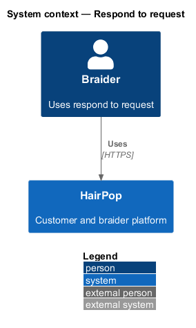
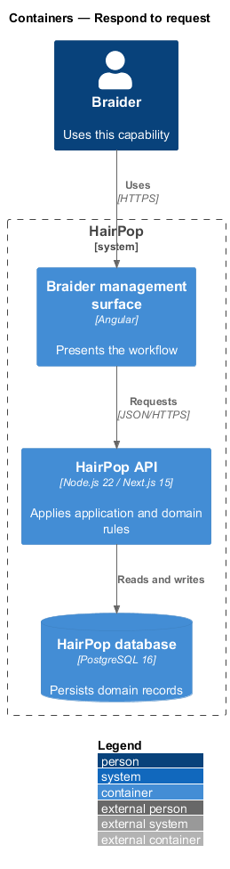
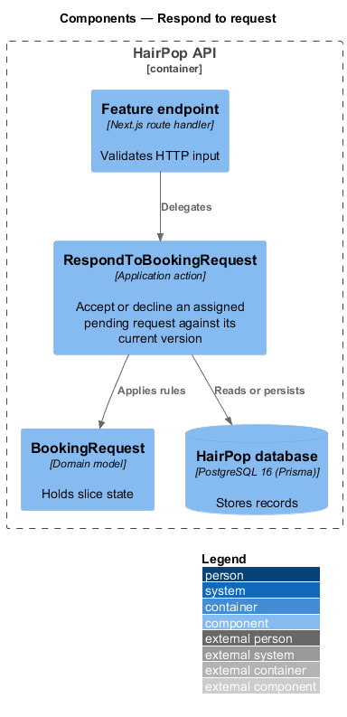
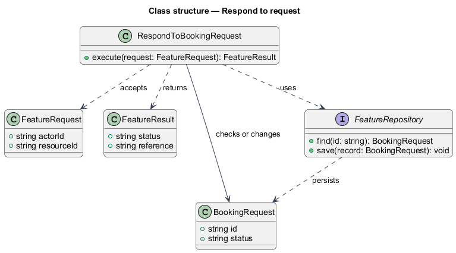
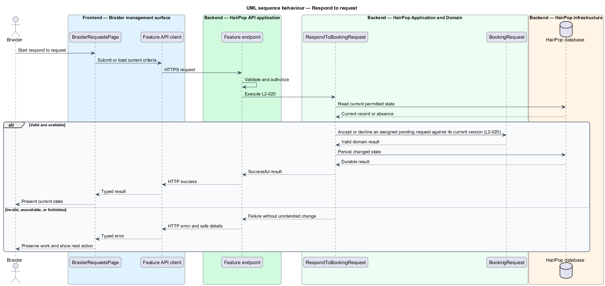

# Respond to request

## Overview

HairPop connects customers with braiders through published styles, service offerings, and appointment workflows. The appointments subsystem supports this braider workflow. The `BookingRequest` is the domain record that carries this slice's state. The slice addresses `L2-020`. Its central behavior is to accept or decline an assigned pending request against its current version.

## Description

`BraiderRequestsPage` is the proposed Angular screen or dialog for this slice. It reads a typed API contract through an injection token and presents the states represented in the mocks. `RespondToBookingRequest` is the proposed application action in the Next.js API. Its responsibility is to accept or decline an assigned pending request against its current version. The API contract for this slice is listed below. A thin Next.js route handler validates the request and delegates to the action. The `BookingRequest` model holds the persisted state relevant to the action. Ownership and publication checks run before private fields are returned or changed. The repository persists or reads records through Prisma.

**Frontend.** A change request is answered with the same dialog; accepting it moves the agreed time (L2-021 AC3). `stale` keeps the dialog open with a refresh action (L2-020 AC3, L2-047 AC4).

| Part | Value |
|------|-------|
| Application | braider |
| Route | `/manage/requests` |
| Components | `BraiderRequestsPage`, `RespondToRequestDialog` |
| API token | `BRAIDER_REQUESTS_API` (`BraiderRequestsApi`) |
| Render mode | Browser (braider app) |
| Mocks | `pages/braider-requests/*`, `dialogs/respond-to-request/*`, `notifications/braider-feedback/*` |

**API contract.** All paths are relative to the API origin; JSON bodies; errors use `ApiErrorBody`.

| Method | Path | Access | Request | Success | Errors |
|--------|------|--------|---------|---------|--------|
| GET | `/api/braider/requests` | braider | — | 200 `{ data: BraiderRequest[] }` | 401; 403 not a braider |
| POST | `/api/braider/requests/{ref}/responses` | braider (assigned) | `{ decision: 'accept' \| 'decline'; agreedAmount: number \| null; version: number }` | 200 `{ status: 'confirmed' \| 'declined' }` | 409 `stale`; 403; 422 `errors.agreedAmount` |

```ts
interface BraiderRequest {
  reference: string; kind: 'booking' | 'change'; customer: { name: string }; service: string;
  start: IsoDateTime; previousStart: IsoDateTime | null; durationHours: number;
  estimate: Range | null; agreedAmount: number | null; hairDetails: string; version: number;
}
```

## Requirements

| L2 ID | Refines (L1) | Requirement |
|-------|--------------|-------------|
| `L2-020` | `L1-006` | The request's braider must be able to accept or decline it from an existing authenticated management surface. Acceptance must record the agreed time and amount status; a stale response must not overwrite a later state. |
| `L2-047` | `L1-015` | Each braider management screen and dialog must implement the states listed for it in the mock manifest, edit through dialogs or dedicated screens rather than inline page forms, and report conflicts without overwriting newer data. |

## Diagrams

### System context

The braider uses HairPop for this capability. HairPop owns the state and publishes only the permitted result.



### Containers

The braider management surface calls the Next.js API. The API reads or changes the HairPop database.



### Components

The API endpoint delegates to `RespondToBookingRequest`. The action applies the relevant rules around `BookingRequest` and persistence.



### Class structure

`RespondToBookingRequest` receives a typed request, uses `BookingRequest`, and returns a typed result.



### Behaviour

The sequence applies `L2-020` while handling invalid or unavailable state without reporting success.


