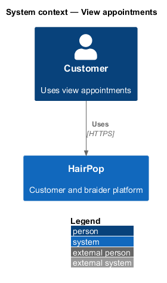
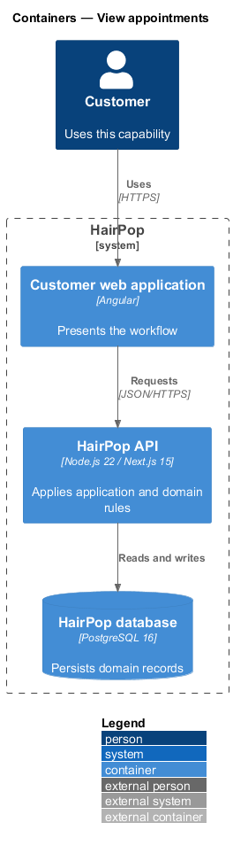
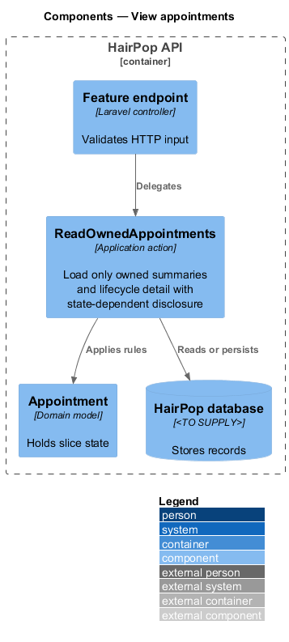
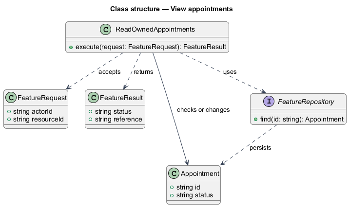
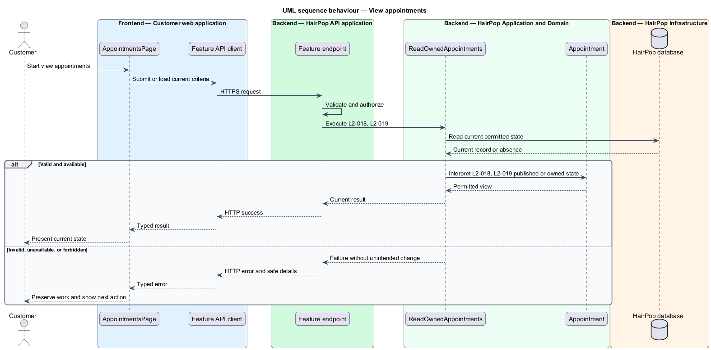

# View appointments

## Overview

HairPop connects customers with braiders through published styles, service offerings, and appointment workflows. The appointments subsystem supports this customer workflow. The `Appointment` is the domain record that carries this slice's state. The slice addresses `L2-018`, `L2-019`. Its central behavior is to load only owned summaries and lifecycle detail with state-dependent disclosure.

## Description

`AppointmentsPage` is the proposed Angular screen or dialog for this slice. It reads a typed API contract through an injection token and presents the states represented in the mocks. `ReadOwnedAppointments` is the proposed application action in the Next.js API. Its responsibility is to load only owned summaries and lifecycle detail with state-dependent disclosure. The API contract for this slice is listed below. A thin Next.js route handler validates the request and delegates to the action. The `Appointment` model holds the persisted state relevant to the action. Ownership and publication checks run before private fields are returned or changed. The repository persists or reads records through Prisma.

**Frontend.** A 404 for a reference renders the access-unavailable page (L2-019 AC4, L2-037 AC3). The last successful detail per reference is kept in session storage for the offline state and cleared at sign-out (L2-045).

**Backend.** `ReadOwnedAppointments` reads only the signed-in customer's `Appointment` rows; any other reference — another customer's, unknown or malformed — is 404 `{ message: 'Not found.' }`. `completed` is not stored: a confirmed appointment reads as completed once its start plus duration has passed. `upcoming` means a start from now on (soonest first); `past` and `all` list the latest first. `search` matches the service or braider name case-insensitively, or a reference such as `HP-1048` or `1048`. `price` is the snapshot estimate, or `{ kind: 'agreed', min: amount, max: amount }` once the braider agreed an amount. `location.address` is the studio address only for confirmed or completed appointments (L2-027 AC3). `preparation` lists the braider's preparation guidance and the service's own, one item per line, or `null` when neither exists (L2-024 AC3). `allowed.change` needs an active item at least 48 hours away with no pending change; `allowed.cancel` needs an active item that has not started; `rebook` and `review` need a completed visit (`review` also needs no review yet). Every fact comes from one read, so `unavailable` is always empty.

| Part | Value |
|------|-------|
| Application | customer |
| Route | `/appointments` and `/appointments/:ref` |
| Components | `AppointmentsPage`, `AppointmentDetailPage` |
| API token | `APPOINTMENTS_API` (`AppointmentsApi`) |
| Render mode | Browser (signed in) |
| Mocks | `pages/my-appointments/*`, `pages/appointment-detail/*` |

**API contract.** All paths are relative to the API origin; JSON bodies; errors use `ApiErrorBody`.

| Method | Path | Access | Request | Success | Errors |
|--------|------|--------|---------|---------|--------|
| GET | `/api/appointments?filter&search&page` | customer | query: `filter` (`all` \| `upcoming` \| `past`), `search`, `page` | 200 `Page<AppointmentSummary>` | 401 |
| GET | `/api/appointments/{ref}` | customer (owner) | — | 200 `AppointmentDetail` | 401; 404 unknown or another customer's reference (no disclosure) |

```ts
type AppointmentStatus = 'awaiting_reply' | 'confirmed' | 'declined' | 'cancelled' | 'completed';
interface Price { kind: 'estimate' | 'agreed'; min: number; max: number | null }
interface AppointmentSummary {
  reference: string; status: AppointmentStatus; service: string; braider: { slug: string; name: string };
  start: IsoDateTime; timeZone: string; price: Price;
}
interface AppointmentDetail extends AppointmentSummary {
  durationHours: number; location: { area: string; address: string | null };   // address only once confirmed
  contact: { email: string; phone: string | null };
  policy: { changes: string; cancellation: string };
  preparation: string[] | null;
  pendingChange: { start: IsoDateTime } | null;
  allowed: { change: boolean; cancel: boolean; rebook: boolean; review: boolean };
  unavailable: 'preparation'[];
  updatedAt: IsoDateTime;
}
```

## Requirements

| L2 ID | Refines (L1) | Requirement |
|-------|--------------|-------------|
| `L2-018` | `L1-006` | My Appointments must show only the signed-in customer's requests and appointments, including upcoming and past items and their current status, with links to detail or care and review as appropriate. |
| `L2-019` | `L1-006` | The detail screen must reflect the current lifecycle state and show the service, braider, local time, price status, available location, contact path, policy, preparation checklist, and allowed actions. |

## Diagrams

### System context

The customer uses HairPop for this capability. HairPop owns the state and publishes only the permitted result.



### Containers

The customer web application calls the Next.js API. The API reads or changes the HairPop database.



### Components

The API endpoint delegates to `ReadOwnedAppointments`. The action applies the relevant rules around `Appointment` and persistence.



### Class structure

`ReadOwnedAppointments` receives a typed request, uses `Appointment`, and returns a typed result.



### Behaviour

The sequence applies `L2-018`, `L2-019` while handling invalid or unavailable state without reporting success.


