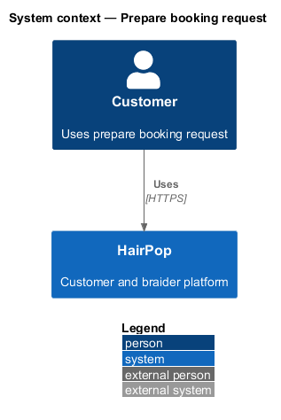
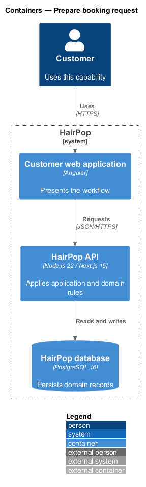
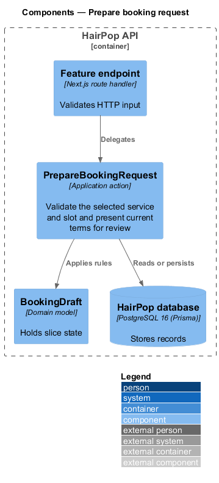
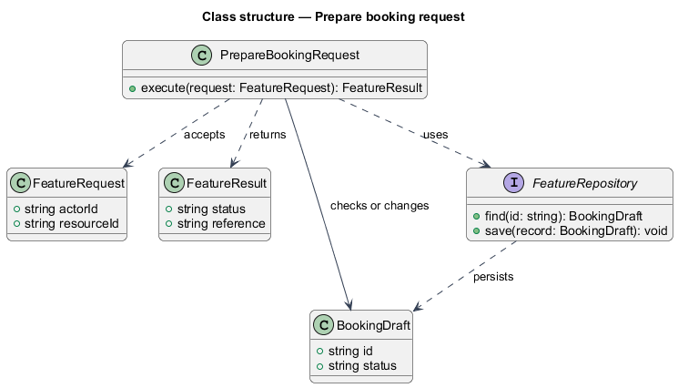
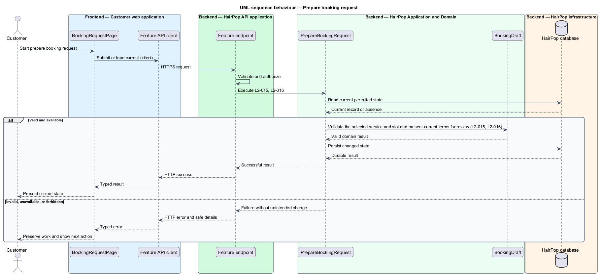

# Prepare booking request

## Overview

HairPop connects customers with braiders through published styles, service offerings, and appointment workflows. The booking subsystem supports this customer workflow. The `BookingDraft` is the domain record that carries this slice's state. The slice addresses `L2-015`, `L2-016`. Its central behavior is to validate the selected service and slot and present current terms for review.

## Description

`BookingRequestPage` is the proposed Angular screen or dialog for this slice. It reads a typed API contract through an injection token and presents the states represented in the mocks. `PrepareBookingRequest` is the proposed application action in the Next.js API. Its responsibility is to validate the selected service and slot and present current terms for review. The API contract for this slice is listed below. A thin Next.js route handler validates the request and delegates to the action. The `BookingDraft` model holds the persisted state relevant to the action. Ownership and publication checks run before private fields are returned or changed. The repository persists or reads records through Prisma.

**Frontend.** Review request opens a CDK dialog with the current values; closing it keeps every entry (L2-016 AC2). No slots renders the empty state.

| Part | Value |
|------|-------|
| Application | customer |
| Route | `/book/:braiderSlug?service=:id` |
| Components | `BookingRequestPage`, `RequestReviewDialog` |
| API token | `BOOKING_API` (`BookingApi`) |
| Render mode | Browser (signed in) |
| Mocks | `pages/booking-request/*`, `dialogs/request-review/*` |

**API contract.** All paths are relative to the API origin; JSON bodies; errors use `ApiErrorBody`.

| Method | Path | Access | Request | Success | Errors |
|--------|------|--------|---------|---------|--------|
| GET | `/api/braiders/{slug}/booking-options` | customer | — | 200 `BookingOptions` | 401; 404 |

```ts
interface BookingOptions {
  braider: { slug: string; name: string; area: string };
  services: { id: string; name: string; startingPrice: number; typicalHours: number; estimate: Range }[];
  slots: { id: string; start: IsoDateTime }[];
  policy: { version: string; changes: string; cancellation: string };
  contact: { email: string; phone: string | null };
  timeZone: string;                                          // America/Toronto
}
```

## Requirements

| L2 ID | Refines (L1) | Requirement |
|-------|--------------|-------------|
| `L2-015` | `L1-005` | The booking request must use a service currently offered by the selected braider and a currently offered time, and collect customer contact and hair details shown in the mock. |
| `L2-016` | `L1-005` | Before final submission, the customer must be able to review the selected service and time, estimated price and duration, location or service area, applicable cancellation policy, contact details, and hair details. |

## Diagrams

### System context

The customer uses HairPop for this capability. HairPop owns the state and publishes only the permitted result.



### Containers

The customer web application calls the Next.js API. The API reads or changes the HairPop database.



### Components

The API endpoint delegates to `PrepareBookingRequest`. The action applies the relevant rules around `BookingDraft` and persistence.



### Class structure

`PrepareBookingRequest` receives a typed request, uses `BookingDraft`, and returns a typed result.



### Behaviour

The sequence applies `L2-015`, `L2-016` while handling invalid or unavailable state without reporting success.


