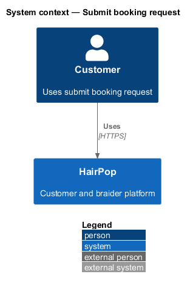
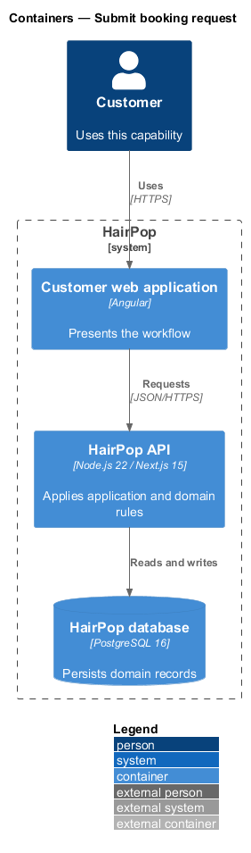
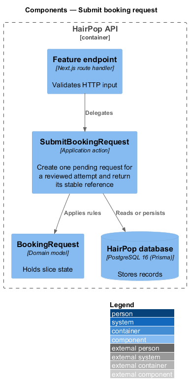
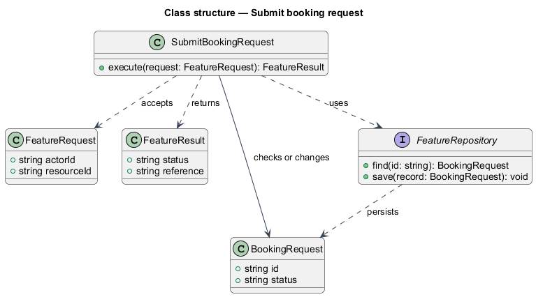
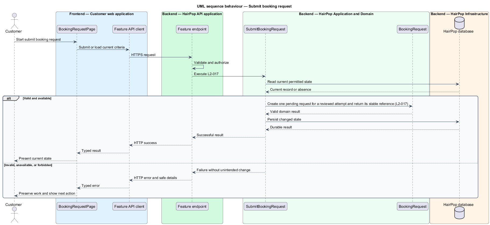

# Submit booking request

## Overview

HairPop connects customers with braiders through published styles, service offerings, and appointment workflows. The booking subsystem supports this customer workflow. The `BookingRequest` is the domain record that carries this slice's state. The slice addresses `L2-017`. Its central behavior is to create one pending request for a reviewed attempt and return its stable reference.

## Description

`BookingRequestPage` is the proposed Angular screen or dialog for this slice. It reads a typed API contract through an injection token and presents the states represented in the mocks. `SubmitBookingRequest` is the proposed application action in the Next.js API. Its responsibility is to create one pending request for a reviewed attempt and return its stable reference. The API contract for this slice is listed below. A thin Next.js route handler validates the request and delegates to the action. The `BookingRequest` model holds the persisted state relevant to the action. Ownership and publication checks run before private fields are returned or changed. The repository persists or reads records through Prisma.

**Frontend.** One idempotency key is created when the review dialog opens and reused for every retry of that attempt (L2-017 AC2). `terms_changed` reloads the options and returns to review (L2-016 AC3); `slot_unavailable` and `service_unavailable` mark the field to reselect (L2-015 AC2).

| Part | Value |
|------|-------|
| Application | customer |
| Route | `/book/:braiderSlug` |
| Components | `BookingRequestPage`, `RequestReviewDialog` |
| API token | `BOOKING_API` (`BookingApi.submit`) |
| Render mode | Browser (signed in) |
| Mocks | `pages/booking-request/submitting`, `success`, `dialogs/request-review/*` |

**API contract.** All paths are relative to the API origin; JSON bodies; errors use `ApiErrorBody`.

| Method | Path | Access | Request | Success | Errors |
|--------|------|--------|---------|---------|--------|
| POST | `/api/booking-requests` | customer | header `Idempotency-Key: <uuid per attempt>`; body `{ braiderSlug, serviceId, slotId, email, phone: string \| null, hairDetails, policyVersion }` | 201 `{ reference: 'HP-1048'; status: 'awaiting_reply' }` (a repeated key returns the same body) | 401; 409 `code`: `terms_changed` \| `slot_unavailable` \| `service_unavailable`; 422 field errors; 429 |

## Requirements

| L2 ID | Refines (L1) | Requirement |
|-------|--------------|-------------|
| `L2-017` | `L1-005` | A successful booking submission must create one customer-owned request with a stable reference and an awaiting-reply status; repeat submissions of the same attempt must not create duplicate requests. |

## Diagrams

### System context

The customer uses HairPop for this capability. HairPop owns the state and publishes only the permitted result.

### Containers

The customer web application calls the Next.js API. The API reads or changes the HairPop database.

### Components

The API endpoint delegates to `SubmitBookingRequest`. The action applies the relevant rules around `BookingRequest` and persistence.

### Class structure

`SubmitBookingRequest` receives a typed request, uses `BookingRequest`, and returns a typed result.

### Behaviour

The sequence applies `L2-017` while handling invalid or unavailable state without reporting success.

