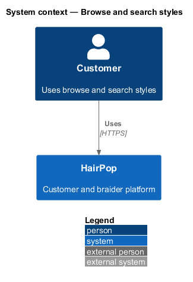
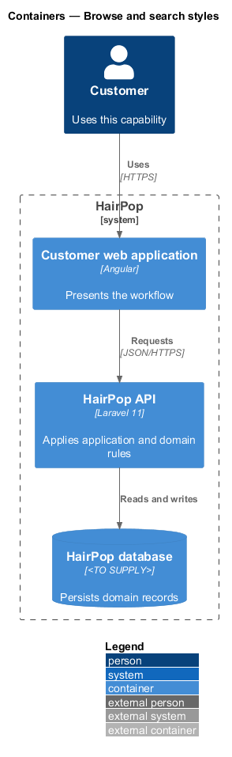
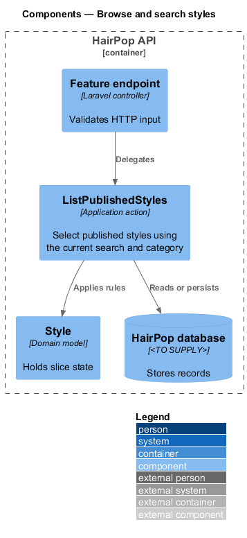
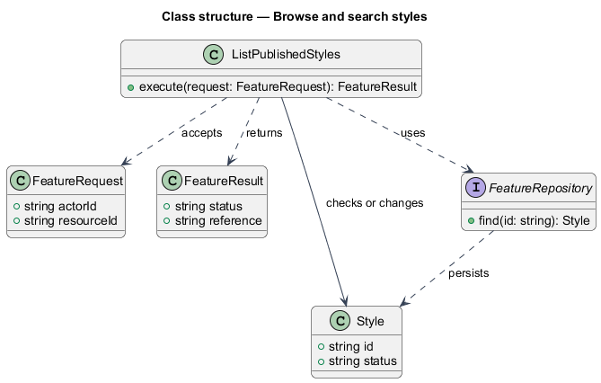
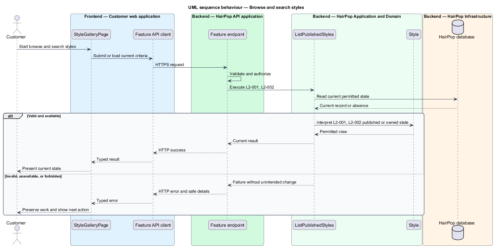

# Browse and search styles

## Overview

HairPop connects customers with braiders through published styles, service offerings, and appointment workflows. The discovery subsystem supports this customer workflow. The `Style` is the domain record that carries this slice's state. The slice addresses `L2-001`, `L2-002`. Its central behavior is to select published styles using the current search and category.

## Description

`StyleGalleryPage` is the proposed Angular screen or dialog for this slice. It reads a typed API contract through an injection token and presents the states represented in the mocks. `ListPublishedStyles` is the proposed Laravel application action. Its responsibility is to select published styles using the current search and category. The API route and request and response schema are <TO SUPPLY>. A thin Laravel controller validates the request and delegates to the action. The `Style` model holds the persisted state relevant to the action. Ownership and publication checks run before private fields are returned or changed. The repository persists or reads records through Laravel data access.

## Requirements

| L2 ID | Refines (L1) | Requirement |
|-------|--------------|-------------|
| `L2-001` | `L1-001` | The gallery must show published styles with a name, representative image, and available typical duration and price information, and open the selected style detail. |
| `L2-002` | `L1-001` | Visitors must be able to search published styles by name and select the categories shown in the gallery; the visible cards and active controls must reflect the current criteria. |

## Diagrams

### System context

The customer uses HairPop for this capability. HairPop owns the state and publishes only the permitted result.

### Containers

The customer web application calls the Laravel API. The API reads or changes the HairPop database.

### Components

The API endpoint delegates to `ListPublishedStyles`. The action applies the relevant rules around `Style` and persistence.

### Class structure

`ListPublishedStyles` receives a typed request, uses `Style`, and returns a typed result.

### Behaviour

The sequence applies `L2-001`, `L2-002` while handling invalid or unavailable state without reporting success.

