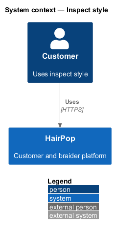
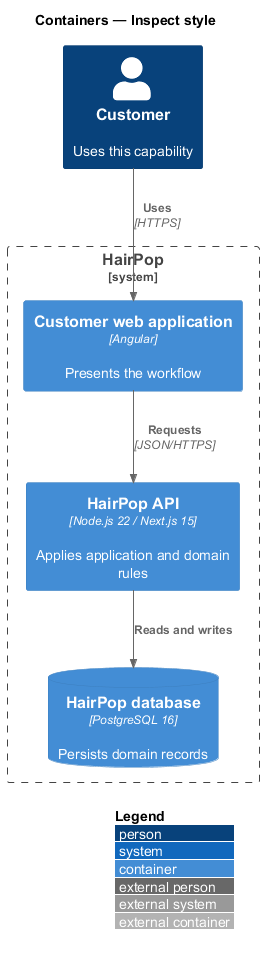
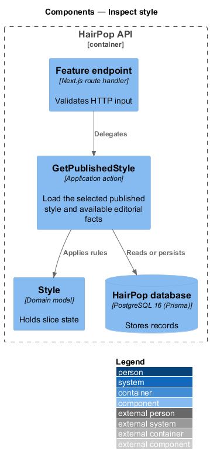
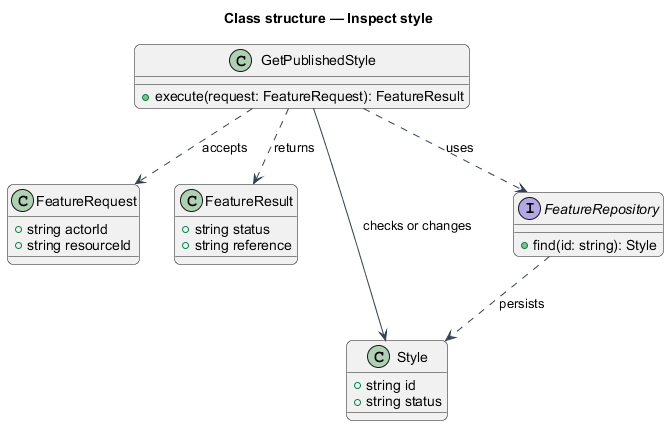
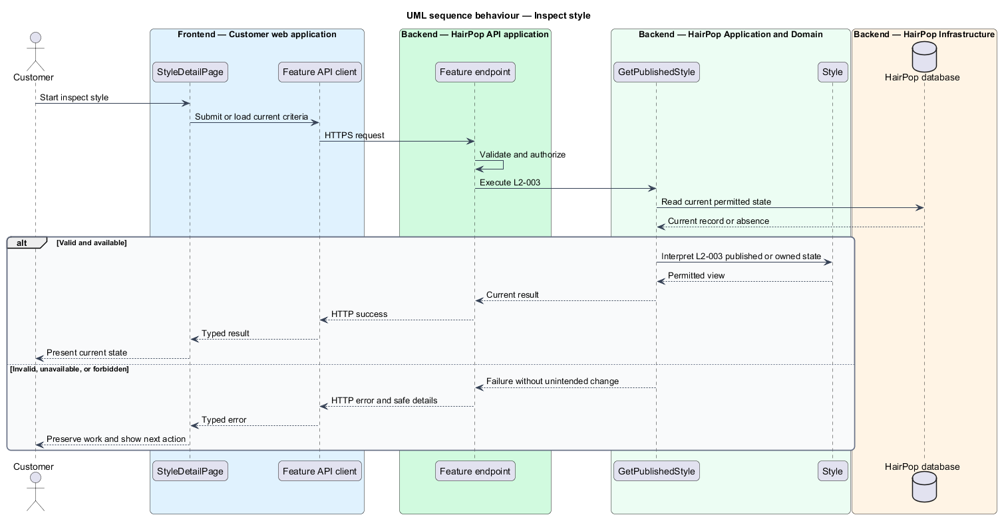

# Inspect style

## Overview

HairPop connects customers with braiders through published styles, service offerings, and appointment workflows. The discovery subsystem supports this customer workflow. The `Style` is the domain record that carries this slice's state. The slice addresses `L2-003`. Its central behavior is to load the selected published style and available editorial facts.

## Description

`StyleDetailPage` is the proposed Angular screen or dialog for this slice. It reads a typed API contract through an injection token and presents the states represented in the mocks. `GetPublishedStyle` is the proposed Laravel application action. Its responsibility is to load the selected published style and available editorial facts. The API contract for this slice is listed below. A thin Laravel controller validates the request and delegates to the action. The `Style` model holds the persisted state relevant to the action. Ownership and publication checks run before private fields are returned or changed. The repository persists or reads records through Laravel data access.

**Frontend.** A fact that is `null` is omitted; a fact listed in `unavailable` shows the partial-data warning with a retry (L2-003, L2-036).

| Part | Value |
|------|-------|
| Application | customer |
| Route | `/styles/:slug` |
| Components | `StyleDetailPage` |
| API token | `STYLES_API` (`StylesApi`) |
| Render mode | Server; an unknown slug renders the not-found page with HTTP 404 |
| Mocks | `pages/style-detail/*` |

**API contract.** All paths are relative to the API origin; JSON bodies; errors use `ApiErrorBody`.

| Method | Path | Access | Request | Success | Errors |
|--------|------|--------|---------|---------|--------|
| GET | `/api/styles/{slug}` | public | — | 200 `StyleDetail` | 404 unknown or unpublished |

```ts
interface StyleDetail extends StyleSummary {
  intro: string; typicalWear: Range | null;
  variations: { name: string; description: string }[]; quoteFactors: string[];
  unavailable: ('typicalWear' | 'variations' | 'quoteFactors')[];   // optional facts that failed to load
}
```

## Requirements

| L2 ID | Refines (L1) | Requirement |
|-------|--------------|-------------|
| `L2-003` | `L1-001` | A published style detail must explain its variations, typical duration, typical price, expected wear or upkeep, and factors that can change the final quote, using only fields available for that style. |

## Diagrams

### System context

The customer uses HairPop for this capability. HairPop owns the state and publishes only the permitted result.



### Containers

The customer web application calls the Laravel API. The API reads or changes the HairPop database.



### Components

The API endpoint delegates to `GetPublishedStyle`. The action applies the relevant rules around `Style` and persistence.



### Class structure

`GetPublishedStyle` receives a typed request, uses `Style`, and returns a typed result.



### Behaviour

The sequence applies `L2-003` while handling invalid or unavailable state without reporting success.


