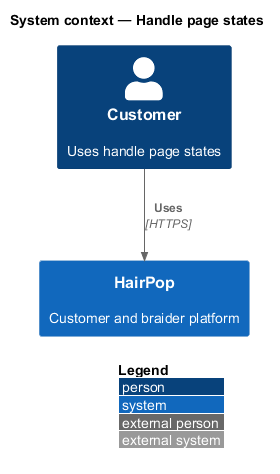
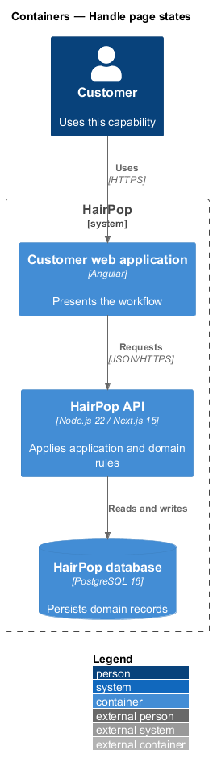
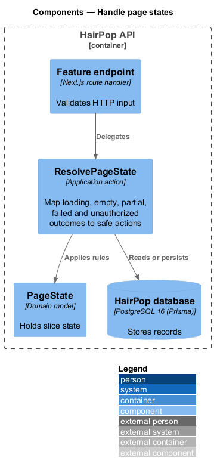
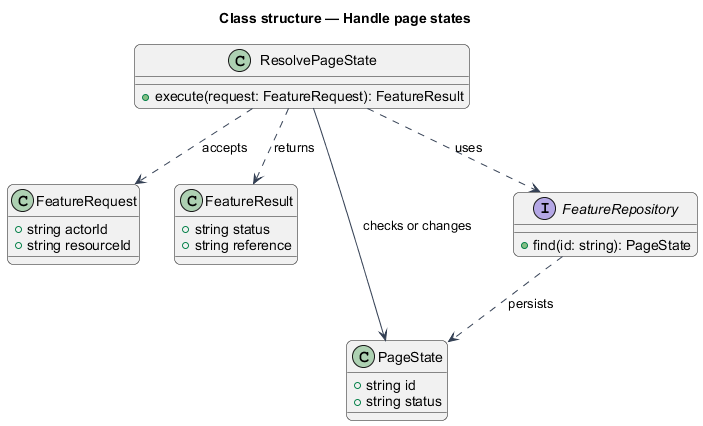
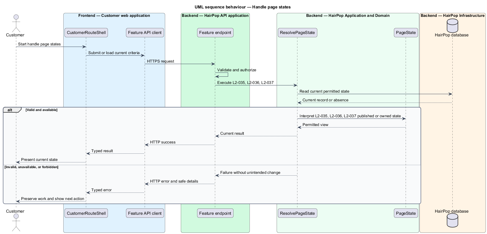

# Handle page states

## Overview

HairPop connects customers with braiders through published styles, service offerings, and appointment workflows. The experience subsystem supports this customer workflow. The `PageState` is the domain record that carries this slice's state. The slice addresses `L2-035`, `L2-036`, `L2-037`. Its central behavior is to map loading, empty, partial, failed and unauthorized outcomes to safe actions.

## Description

`CustomerRouteShell` is the proposed Angular screen or dialog for this slice. It reads a typed API contract through an injection token and presents the states represented in the mocks. `ResolvePageState` is the proposed application action in the Next.js API. Its responsibility is to map loading, empty, partial, failed and unauthorized outcomes to safe actions. The API contract for this slice is listed below. A thin Next.js route handler validates the request and delegates to the action. The `PageState` model holds the persisted state relevant to the action. Ownership and publication checks run before private fields are returned or changed. The repository persists or reads records through Prisma.

**Frontend.** Each page models its state as a `PageState<T>` signal (`loading`, `ready`, `empty`, `error`, `offline`) so the mock states map one to one.

| Part | Value |
|------|-------|
| Application | customer and braider |
| Route | `/404`, `/403`, `/500`, `/offline`, `**` |
| Components | `CustomerRouteShell`, `NotFoundPage`, `ForbiddenPage`, `ServerErrorPage`, `OfflinePage` |
| API token | all feature tokens |
| Render mode | Server for error routes, with the matching HTTP status (`/403` 403, `/500` 500, `/404` and the catch-all 404, `/offline` 200) |
| Query | `/500?reference=<support reference>&at=<ISO time>` shows "Reference: … · Sat 10 Oct, 9:42 am"; both are optional |
| Try again | On `/500` and `/offline` it goes back in history, so a failed state-changing request is never resent (L2-037 AC4) |
| Mocks | `pages/not-found/*`, `pages/forbidden/*`, `pages/server-error/*`, `pages/offline/*` |

**API contract.** All paths are relative to the API origin; JSON bodies; errors use `ApiErrorBody`.

| Method | Path | Access | Request | Success | Errors |
|--------|------|--------|---------|---------|--------|
| — | shared rules for every endpoint | — | — | `Page<T>` for lists | 401 → sign-in; 403/404 → destination page; 409 → in-place conflict; 422 → field errors and summary; 429 → retry message; 5xx → error state or `/500` with `reference` |

```ts
// Shared shapes (frontend/projects/api/src/lib/common.ts)
interface Page<T> { data: T[]; meta: { page: number; perPage: number; total: number; lastPage: number } }
interface ApiErrorBody { message: string; code?: string; errors?: Record<string, string[]>; reference?: string; retryAfter?: number }
interface Range { min: number; max: number | null }            // whole CAD dollars, hours or weeks
interface Image { src: string; alt: string }
type IsoDateTime = string;                                        // 2026-10-24T10:00:00-04:00
```

## Requirements

| L2 ID | Refines (L1) | Requirement |
|-------|--------------|-------------|
| `L2-035` | `L1-011` | Each page must implement the applicable states listed for it in the mock manifest and distinguish an empty data set from criteria that yield no results. |
| `L2-036` | `L1-011` | Validation, submitting, failed, partial, and offline states must match the manifest and preserve entered work when retry is possible. |
| `L2-037` | `L1-011` | Unknown pages, unauthorized resources, server errors, and offline navigation must use the corresponding mock destination with an appropriate next action. |
| `L2-047` | `L1-015` | Each braider management screen and dialog must implement the states listed for it in the mock manifest, edit through dialogs or dedicated screens rather than inline page forms, and report conflicts without overwriting newer data. |

## Diagrams

### System context

The customer uses HairPop for this capability. HairPop owns the state and publishes only the permitted result.



### Containers

The customer web application calls the Next.js API. The API reads or changes the HairPop database.



### Components

The API endpoint delegates to `ResolvePageState`. The action applies the relevant rules around `PageState` and persistence.



### Class structure

`ResolvePageState` receives a typed request, uses `PageState`, and returns a typed result.



### Behaviour

The sequence applies `L2-035`, `L2-036`, `L2-037` while handling invalid or unavailable state without reporting success.


