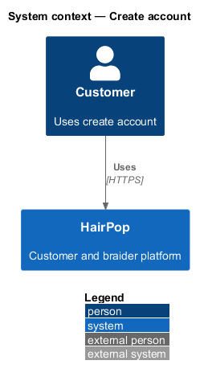
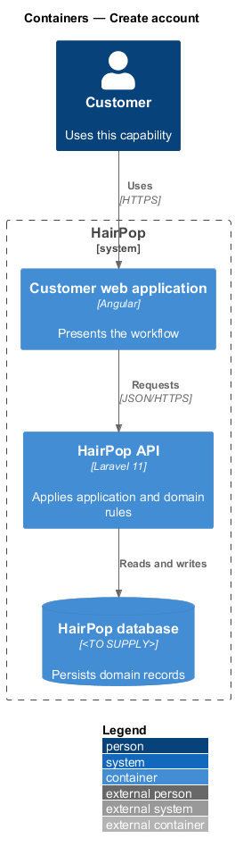
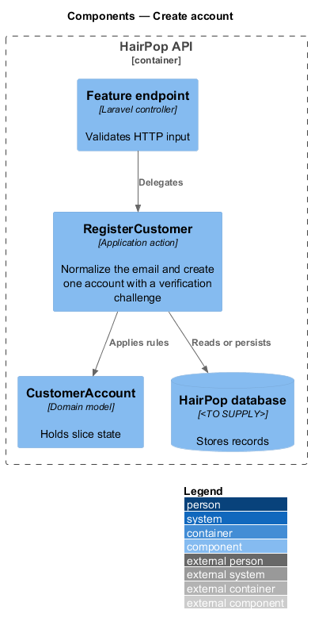
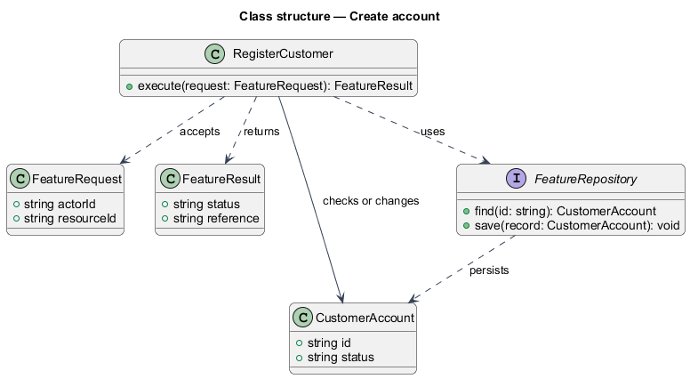
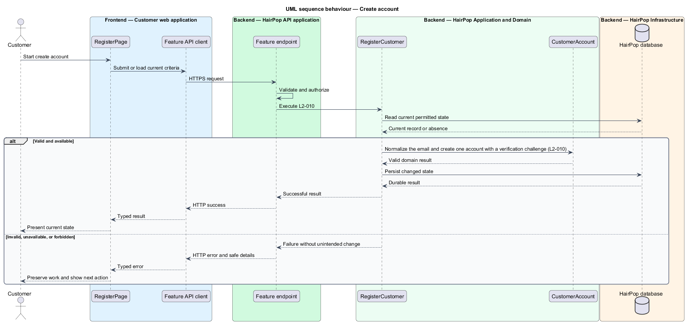

# Create account

## Overview

HairPop connects customers with braiders through published styles, service offerings, and appointment workflows. The identity subsystem supports this customer workflow. The `CustomerAccount` is the domain record that carries this slice's state. The slice addresses `L2-010`. Its central behavior is to normalize the email and create one account with a verification challenge.

## Description

`RegisterPage` is the proposed Angular screen or dialog for this slice. It reads a typed API contract through an injection token and presents the states represented in the mocks. `RegisterCustomer` is the proposed Laravel application action. Its responsibility is to normalize the email and create one account with a verification challenge. The API contract for this slice is listed below. A thin Laravel controller validates the request and delegates to the action. The `CustomerAccount` model holds the persisted state relevant to the action. Ownership and publication checks run before private fields are returned or changed. The repository persists or reads records through Laravel data access.

**Frontend.** Success shows the next step and links to `/verify-email`; a registered email receives a sign-in reminder instead, so the response reveals nothing (L2-010 AC3).

| Part | Value |
|------|-------|
| Application | customer |
| Route | `/sign-up` |
| Components | `RegisterPage` |
| API token | `AUTH_API` (`AuthApi.register`) |
| Render mode | Server |
| Mocks | `pages/sign-up/*` |

**API contract.** All paths are relative to the API origin; JSON bodies; errors use `ApiErrorBody`.

| Method | Path | Access | Request | Success | Errors |
|--------|------|--------|---------|---------|--------|
| POST | `/api/auth/register` | public | header `Idempotency-Key`; body `{ name, email, password (≥ 12) }` | 202 `{ email: string }`, the same whether or not the email exists | 422 `errors.email`, `errors.password`; 429 |

## Requirements

| L2 ID | Refines (L1) | Requirement |
|-------|--------------|-------------|
| `L2-010` | `L1-004` | Account creation must accept a name, valid email address, and password of at least 12 characters, avoid duplicate accounts for one normalized email, and begin email verification. |

## Diagrams

### System context

The customer uses HairPop for this capability. HairPop owns the state and publishes only the permitted result.

### Containers

The customer web application calls the Laravel API. The API reads or changes the HairPop database.

### Components

The API endpoint delegates to `RegisterCustomer`. The action applies the relevant rules around `CustomerAccount` and persistence.

### Class structure

`RegisterCustomer` receives a typed request, uses `CustomerAccount`, and returns a typed result.

### Behaviour

The sequence applies `L2-010` while handling invalid or unavailable state without reporting success.

