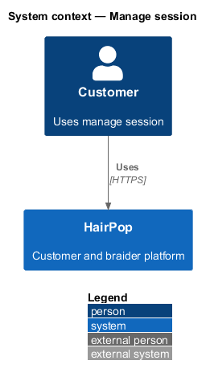
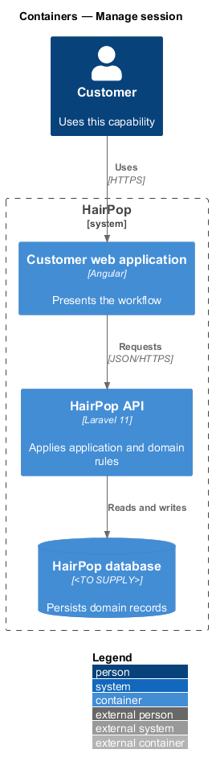
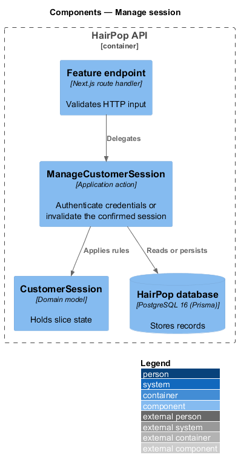
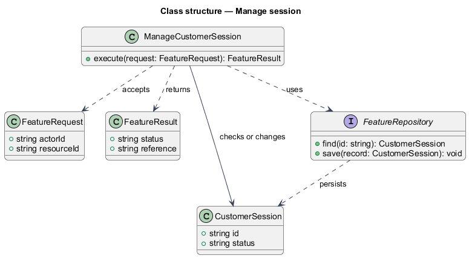
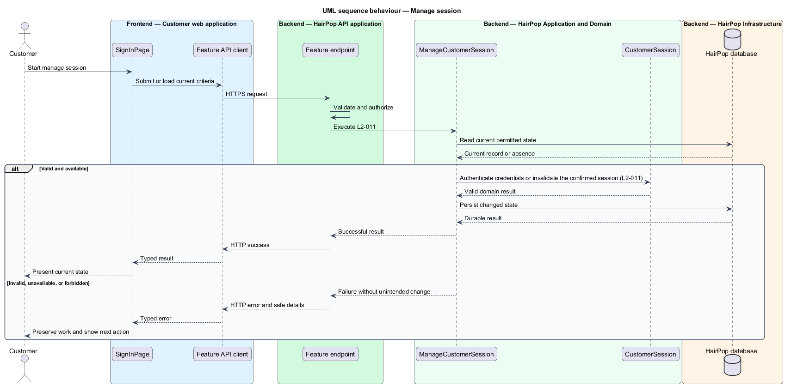

# Manage session

## Overview

HairPop connects customers with braiders through published styles, service offerings, and appointment workflows. The identity subsystem supports this customer workflow. The `CustomerSession` is the domain record that carries this slice's state. The slice addresses `L2-011`. Its central behavior is to authenticate credentials or invalidate the confirmed session.

## Description

`SignInPage` is the proposed Angular screen or dialog for this slice. It reads a typed API contract through an injection token and presents the states represented in the mocks. `ManageCustomerSession` is the proposed Laravel application action. Its responsibility is to authenticate credentials or invalidate the confirmed session. The API contract for this slice is listed below. A thin Laravel controller validates the request and delegates to the action. The `CustomerSession` model holds the persisted state relevant to the action. Ownership and publication checks run before private fields are returned or changed. The repository persists or reads records through Laravel data access.

**Frontend.** Sanctum SPA session cookies with `X-XSRF-TOKEN` (ADR 0003). Protected routes use `authGuard`, which redirects to sign-in with `returnUrl` (L2-037 AC2); the braider app's guard also requires `role: 'braider'` (L2-046).

| Part | Value |
|------|-------|
| Application | customer and braider |
| Route | `/sign-in` (customer), `/manage/sign-in` (braider), sign-out dialogs |
| Components | `SignInPage`, `SignOutDialog`, `BraiderSignInPage`, `BraiderSignOutDialog`, `SessionStore` |
| API token | `AUTH_API` (`AuthApi`) |
| Render mode | Server (customer sign-in); browser (braider app) |
| Mocks | `pages/sign-in/*`, `pages/braider-sign-in/*`, `dialogs/sign-out/*`, `dialogs/braider-sign-out/*` |

**API contract.** All paths are relative to the API origin; JSON bodies; errors use `ApiErrorBody`.

| Method | Path | Access | Request | Success | Errors |
|--------|------|--------|---------|---------|--------|
| GET | `/sanctum/csrf-cookie` | public | — | 204 sets `XSRF-TOKEN` | — |
| GET | `/api/session` | public | — | 200 `{ user: SessionUser }` | 401 no session |
| POST | `/api/auth/sign-in` | public | `{ email, password, audience: 'customer' \| 'braider' }` | 200 `{ user: SessionUser }` | 422 `{ message }` without naming the field; 403 `not_braider` for a customer on the braider app (no session); 429 `retryAfter` |
| POST | `/api/auth/sign-out` | signed in | — | 204 | — |

```ts
interface SessionUser { id: string; name: string; firstName: string; email: string; emailVerified: boolean; role: 'customer' | 'braider' }
```

## Requirements

| L2 ID | Refines (L1) | Requirement |
|-------|--------------|-------------|
| `L2-011` | `L1-004` | Customers must be able to sign in with valid credentials and end the authenticated session through the sign-out confirmation dialog. |
| `L2-046` | `L1-015` | The braider management app must require an authenticated braider session; customer accounts and visitors must not reach braider requests, offerings, profile content, or availability through it. |

## Diagrams

### System context

The customer uses HairPop for this capability. HairPop owns the state and publishes only the permitted result.



### Containers

The customer web application calls the Laravel API. The API reads or changes the HairPop database.



### Components

The API endpoint delegates to `ManageCustomerSession`. The action applies the relevant rules around `CustomerSession` and persistence.



### Class structure

`ManageCustomerSession` receives a typed request, uses `CustomerSession`, and returns a typed result.



### Behaviour

The sequence applies `L2-011` while handling invalid or unavailable state without reporting success.


