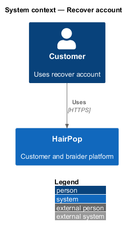
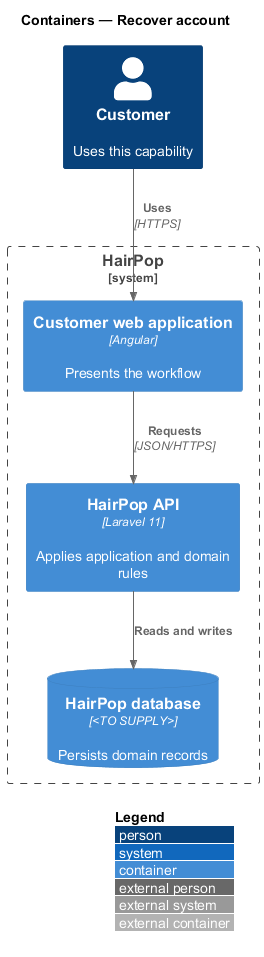
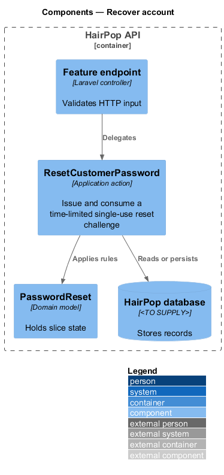
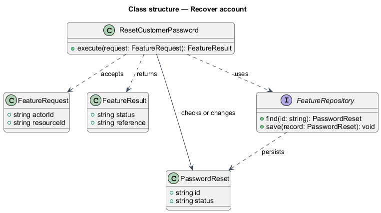
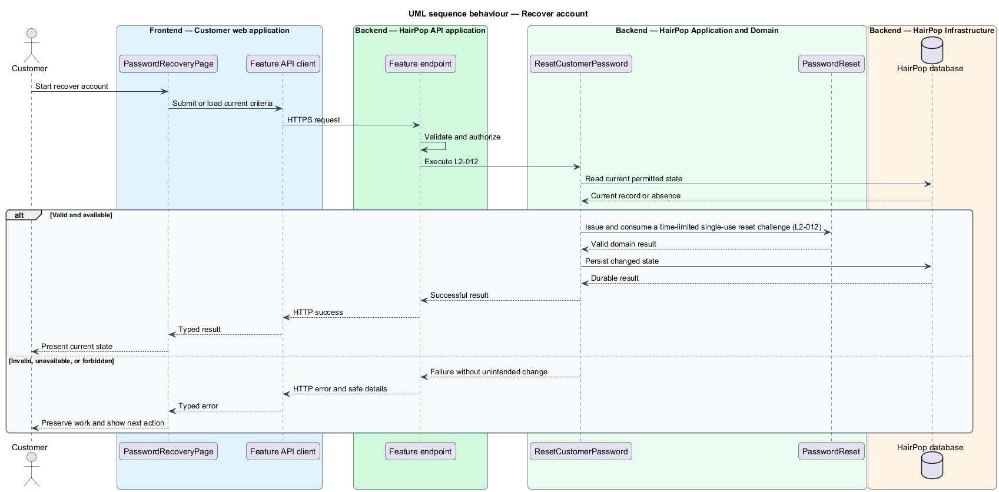

# Recover account

## Overview

HairPop connects customers with braiders through published styles, service offerings, and appointment workflows. The identity subsystem supports this customer workflow. The `PasswordReset` is the domain record that carries this slice's state. The slice addresses `L2-012`. Its central behavior is to issue and consume a time-limited single-use reset challenge.

## Description

`PasswordRecoveryPage` is the proposed Angular screen or dialog for this slice. It reads a typed API contract through an injection token and presents the states represented in the mocks. `ResetCustomerPassword` is the proposed Laravel application action. Its responsibility is to issue and consume a time-limited single-use reset challenge. The API route and request and response schema are <TO SUPPLY>. A thin Laravel controller validates the request and delegates to the action. The `PasswordReset` model holds the persisted state relevant to the action. Ownership and publication checks run before private fields are returned or changed. The repository persists or reads records through Laravel data access.

## Requirements

| L2 ID | Refines (L1) | Requirement |
|-------|--------------|-------------|
| `L2-012` | `L1-004` | Customers must be able to request a time-limited, single-use password reset link and set a new password of at least 12 characters. |

## Diagrams

### System context

The customer uses HairPop for this capability. HairPop owns the state and publishes only the permitted result.

### Containers

The customer web application calls the Laravel API. The API reads or changes the HairPop database.

### Components

The API endpoint delegates to `ResetCustomerPassword`. The action applies the relevant rules around `PasswordReset` and persistence.

### Class structure

`ResetCustomerPassword` receives a typed request, uses `PasswordReset`, and returns a typed result.

### Behaviour

The sequence applies `L2-012` while handling invalid or unavailable state without reporting success.

