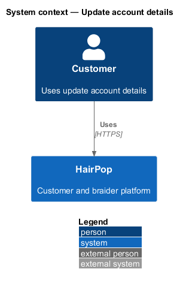
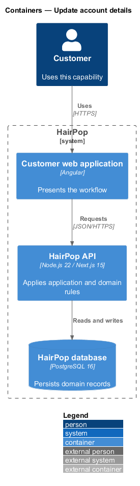
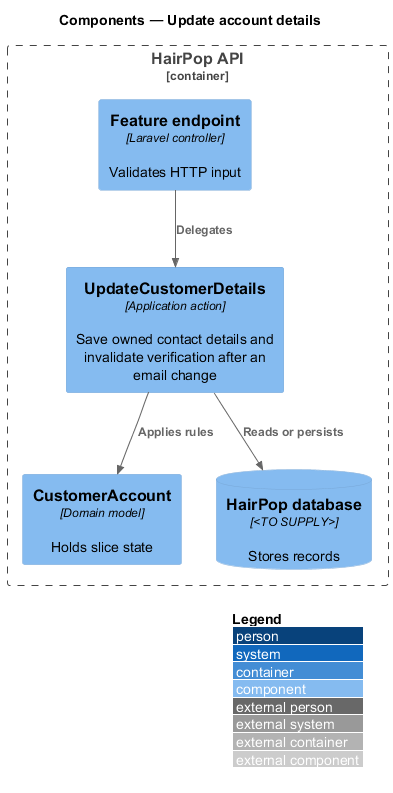
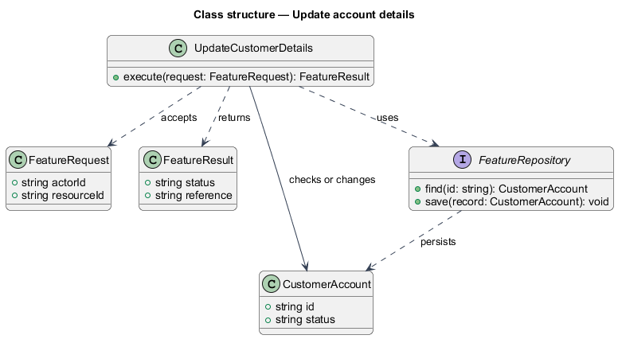
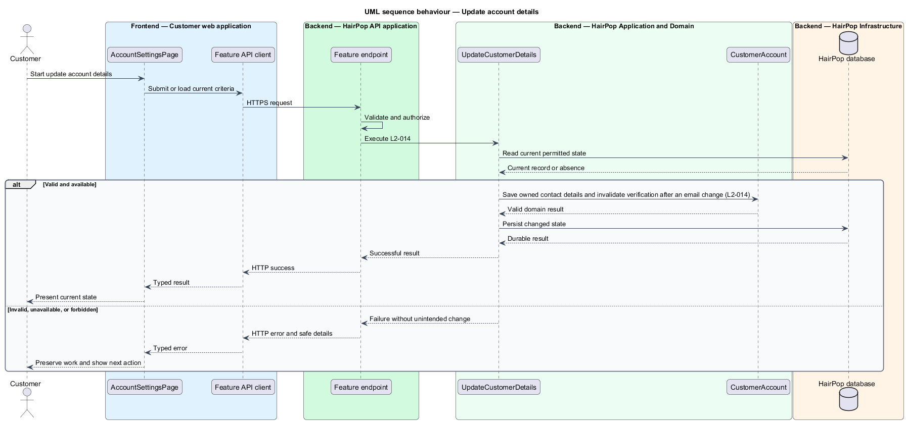

# Update account details

## Overview

HairPop connects customers with braiders through published styles, service offerings, and appointment workflows. The identity subsystem supports this customer workflow. The `CustomerAccount` is the domain record that carries this slice's state. The slice addresses `L2-014`. Its central behavior is to save owned contact details and invalidate verification after an email change.

## Description

`AccountSettingsPage` is the proposed Angular screen or dialog for this slice. It reads a typed API contract through an injection token and presents the states represented in the mocks. `UpdateCustomerDetails` is the proposed application action in the Next.js API. Its responsibility is to save owned contact details and invalidate verification after an email change. The API contract for this slice is listed below. A thin Next.js route handler validates the request and delegates to the action. The `CustomerAccount` model holds the persisted state relevant to the action. Ownership and publication checks run before private fields are returned or changed. The repository persists or reads records through Prisma.

**Frontend.** A changed email comes back as `pendingEmail` until verified (L2-014 AC3).

**Backend.** `UpdateCustomerDetails` trims the name, normalizes the email and stores a blank phone as `null`. An email equal to the account's clears `pendingEmail`; a new address becomes `pendingEmail` and is emailed a verification link in the same transaction — or, when it belongs to another account, a sign-in reminder, so the response never reveals it. Opening the link moves it to `email` (`identity/verify-email`). Each save records "Details updated" or, after a new email, "Verify your new email" (L2-029). The endpoints are customer-only: a braider session gets 403 `not_customer`. Field errors are `errors.name`, `errors.email` and `errors.phone`.

| Part | Value |
|------|-------|
| Application | customer |
| Route | `/settings` |
| Components | `AccountSettingsPage` |
| API token | `ACCOUNT_API` (`AccountApi`) |
| Render mode | Browser (signed in) |
| Mocks | `pages/account-settings/*`, `notifications/account-feedback/*` |

**API contract.** All paths are relative to the API origin; JSON bodies; errors use `ApiErrorBody`.

| Method | Path | Access | Request | Success | Errors |
|--------|------|--------|---------|---------|--------|
| GET | `/api/account` | customer | — | 200 `Account` | 401 |
| PATCH | `/api/account` | customer | `{ name, email, phone: string \| null }` | 200 `Account` | 422 field errors |

```ts
interface Account { name: string; email: string; emailVerified: boolean; pendingEmail: string | null; phone: string | null }
```

## Requirements

| L2 ID | Refines (L1) | Requirement |
|-------|--------------|-------------|
| `L2-014` | `L1-004` | An authenticated customer must be able to update their own name, email, and phone number. A changed email must require verification before it is treated as verified contact information. |

## Diagrams

### System context

The customer uses HairPop for this capability. HairPop owns the state and publishes only the permitted result.



### Containers

The customer web application calls the Next.js API. The API reads or changes the HairPop database.



### Components

The API endpoint delegates to `UpdateCustomerDetails`. The action applies the relevant rules around `CustomerAccount` and persistence.



### Class structure

`UpdateCustomerDetails` receives a typed request, uses `CustomerAccount`, and returns a typed result.



### Behaviour

The sequence applies `L2-014` while handling invalid or unavailable state without reporting success.


