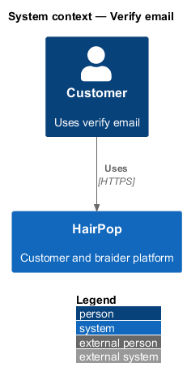
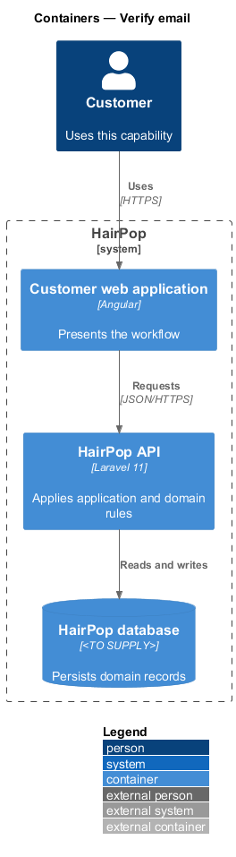
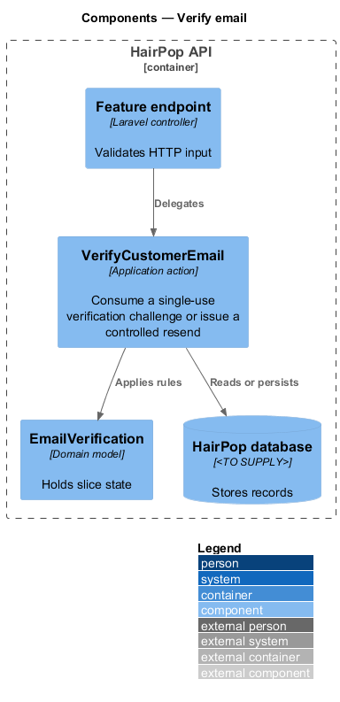
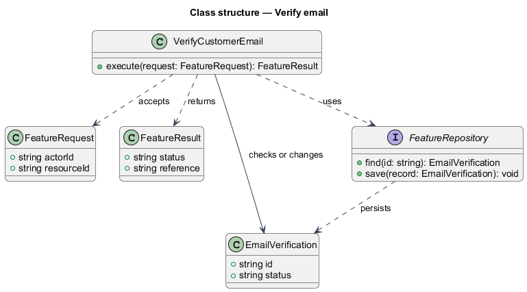
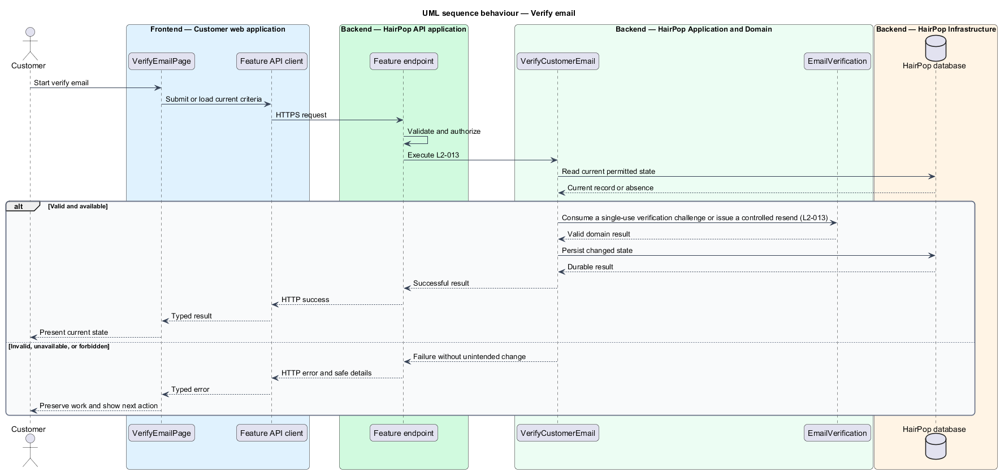

# Verify email

## Overview

HairPop connects customers with braiders through published styles, service offerings, and appointment workflows. The identity subsystem supports this customer workflow. The `EmailVerification` is the domain record that carries this slice's state. The slice addresses `L2-013`. Its central behavior is to consume a single-use verification challenge or issue a controlled resend.

## Description

`VerifyEmailPage` is the proposed Angular screen or dialog for this slice. It reads a typed API contract through an injection token and presents the states represented in the mocks. `VerifyCustomerEmail` is the proposed application action in the Next.js API. Its responsibility is to consume a single-use verification challenge or issue a controlled resend. The API contract for this slice is listed below. A thin Next.js route handler validates the request and delegates to the action. The `EmailVerification` model holds the persisted state relevant to the action. Ownership and publication checks run before private fields are returned or changed. The repository persists or reads records through Prisma.

**Frontend.** With a `token` the page verifies on load; without one it explains the next step and offers Resend email.

**Backend.** `VerifyCustomerEmail` stores only the SHA-256 of each link token (L2-039 AC3); a link lasts 24 hours and is consumed with a conditional update, so two concurrent opens verify once. A link for the account's `pendingEmail` moves that address to `email` (L2-014 AC3); a link for any other address — superseded by a later change — is `invalid_token`. Success records the "Your email is verified" notification (L2-029). Registration queues the link for a new account and a sign-in reminder for a known address in the same transaction as the insert; mail leaves through the outbox ([ADR 0009](../../../adr/0009-email-outbox-worker.md)). Resend answers 202 with no body whether or not the address needs verifying, and is limited to three per address per 15 minutes (L2-040).

| Part | Value |
|------|-------|
| Application | customer |
| Route | `/verify-email?token` |
| Components | `VerifyEmailPage` |
| API token | `AUTH_API` (`AuthApi.verifyEmail`, `resendVerification`) |
| Render mode | Server |
| Mocks | `pages/verify-email/*`, `notifications/account-feedback/*` |

**API contract.** All paths are relative to the API origin; JSON bodies; errors use `ApiErrorBody`.

| Method | Path | Access | Request | Success | Errors |
|--------|------|--------|---------|---------|--------|
| POST | `/api/email/verify` | public | `{ token }` | 200 `{ email: string }` | 422 `code: 'invalid_token'` (expired, altered or used) |
| POST | `/api/email/verification-notification` | public | `{ email }` | 202 | 429 `retryAfter` |

## Requirements

| L2 ID | Refines (L1) | Requirement |
|-------|--------------|-------------|
| `L2-013` | `L1-004` | Account email verification must use a time-limited, single-use link and provide a controlled resend action. |

## Diagrams

### System context

The customer uses HairPop for this capability. HairPop owns the state and publishes only the permitted result.

### Containers

The customer web application calls the Next.js API. The API reads or changes the HairPop database.

### Components

The API endpoint delegates to `VerifyCustomerEmail`. The action applies the relevant rules around `EmailVerification` and persistence.

### Class structure

`VerifyCustomerEmail` receives a typed request, uses `EmailVerification`, and returns a typed result.

### Behaviour

The sequence applies `L2-013` while handling invalid or unavailable state without reporting success.

