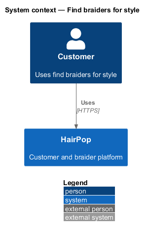
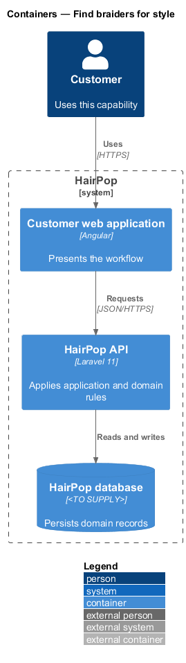
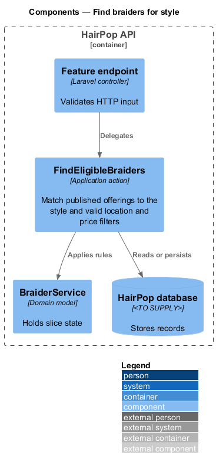
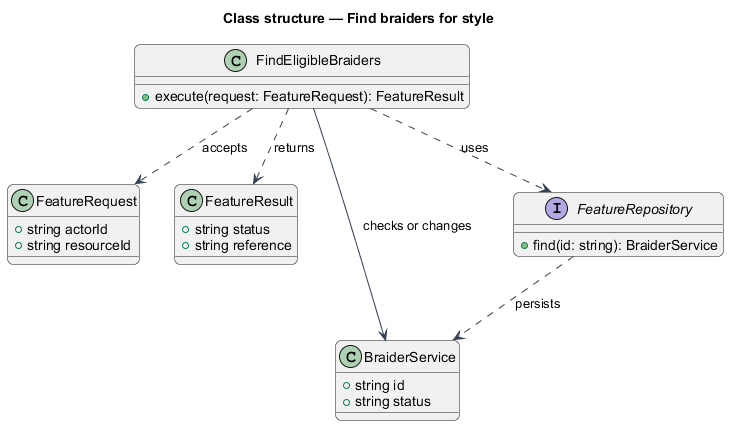
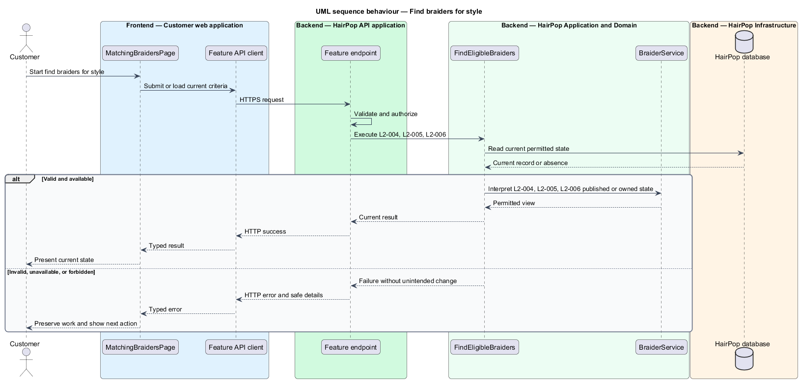

# Find braiders for style

## Overview

HairPop connects customers with braiders through published styles, service offerings, and appointment workflows. The matching subsystem supports this customer workflow. The `BraiderService` is the domain record that carries this slice's state. The slice addresses `L2-004`, `L2-005`, `L2-006`. Its central behavior is to match published offerings to the style and valid location and price filters.

## Description

`MatchingBraidersPage` is the proposed Angular screen or dialog for this slice. It reads a typed API contract through an injection token and presents the states represented in the mocks. `FindEligibleBraiders` is the proposed application action in the Next.js API. Its responsibility is to match published offerings to the style and valid location and price filters. The API contract for this slice is listed below. A thin Next.js route handler validates the request and delegates to the action. The `BraiderService` model holds the persisted state relevant to the action. Ownership and publication checks run before private fields are returned or changed. The repository persists or reads records through Prisma.

**Frontend.** The filter dialog validates `maxPrice` against `meta.style.minPrice` before applying, keeps entered values on failure and holds the confirm button busy while the request runs (L2-005).

**Backend.** `FindEligibleBraiders` returns one match per published braider, carrying their cheapest published service for a published style, ordered by rating (published reviews only, average rounded to one decimal) then review count then name. `search` matches the braider's name or area, case-insensitively. `distanceKm` keeps braiders whose stored distance from central Toronto is within it (the dialog's "Distance from Toronto"). `maxPrice` keeps services starting at or below it, and must be at least `meta.style.minPrice`, the style's lowest typical price; a lower value answers 422 `errors.maxPrice`. `nextAvailable` is the earliest offered slot still in the future.

| Part | Value |
|------|-------|
| Application | customer |
| Route | `/styles/:slug/braiders`; `/braiders` lists every matching braider without a style |
| Components | `MatchingBraidersPage`, `FilterBraidersDialog` |
| API token | `MATCHING_API` (`MatchingApi`) |
| Render mode | Server |
| Query | `q` (search), `maxPrice` (whole dollars), `distanceKm` (5, 10 or 25), `page`; the style stays in the path. Applied price and distance show as chips under the search box; Clear filters drops every query parameter |
| Dialog | Show braiders asks the API for the filtered results first and closes only on success, so a rejected or failed request keeps every entry. The page then navigates and loads the same results again |
| Mocks | `pages/matching-braiders/*`, `dialogs/filter-braiders/*` |

**API contract.** All paths are relative to the API origin; JSON bodies; errors use `ApiErrorBody`.

| Method | Path | Access | Request | Success | Errors |
|--------|------|--------|---------|---------|--------|
| GET | `/api/styles/{slug}/braiders?search&maxPrice&distanceKm&page` | public | query: `search`, `maxPrice` (whole dollars), `distanceKm` (5, 10, 25 or absent), `page` | 200 `Page<BraiderMatch> & { meta: { style: { slug: string; name: string; minPrice: number } } }` | 404 unknown style; 422 `errors.maxPrice`, `errors.distanceKm` |
| GET | `/api/braiders?search&maxPrice&distanceKm&page` | public | as above, no style | 200 `Page<BraiderMatch>` | 422 |

```ts
interface BraiderMatch {
  braider: { slug: string; name: string; area: string; photo: Image | null };
  rating: { average: number; count: number } | null;       // published reviews only (L2-008)
  service: { id: string; name: string; startingPrice: number; typicalHours: number };
  nextAvailable: IsoDateTime | null;                        // null: no offered slot (L2-004 AC2)
}
```

## Requirements

| L2 ID | Refines (L1) | Requirement |
|-------|--------------|-------------|
| `L2-004` | `L1-002` | Matching results must contain only active, published braiders who offer the selected published style, with service area, applicable starting price or range, rating summary where available, and supplied availability information. |
| `L2-005` | `L1-002` | Visitors must be able to search and narrow matching braiders by the mock's price and travel-distance criteria without losing the selected style. |
| `L2-006` | `L1-002` | Each matching result must identify the selected service that made the braider eligible and link to that braider's profile without claiming a personalized or verified match. |

## Diagrams

### System context

The customer uses HairPop for this capability. HairPop owns the state and publishes only the permitted result.



### Containers

The customer web application calls the Next.js API. The API reads or changes the HairPop database.



### Components

The API endpoint delegates to `FindEligibleBraiders`. The action applies the relevant rules around `BraiderService` and persistence.



### Class structure

`FindEligibleBraiders` receives a typed request, uses `BraiderService`, and returns a typed result.



### Behaviour

The sequence applies `L2-004`, `L2-005`, `L2-006` while handling invalid or unavailable state without reporting success.


