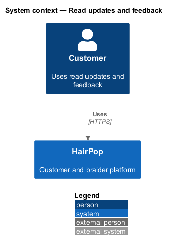
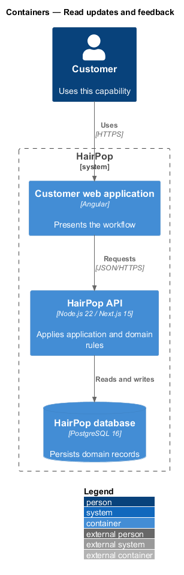
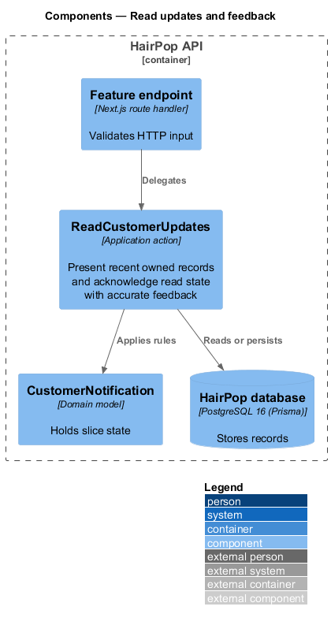
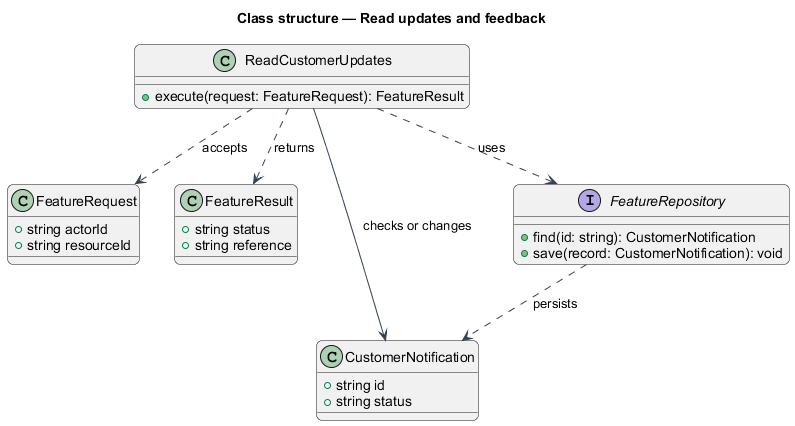
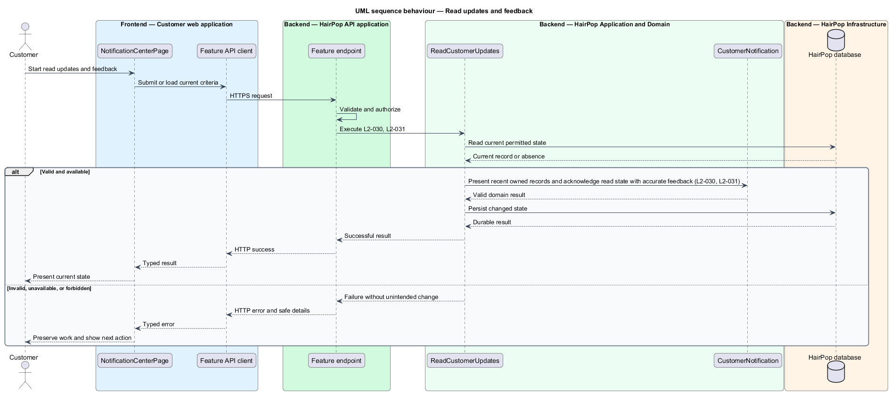

# Read updates and feedback

## Overview

HairPop connects customers with braiders through published styles, service offerings, and appointment workflows. The notifications subsystem supports this customer workflow. The `CustomerNotification` is the domain record that carries this slice's state. The slice addresses `L2-030`, `L2-031`. Its central behavior is to present recent owned records and acknowledge read state with accurate feedback.

## Description

`NotificationCenterPage` is the proposed Angular screen or dialog for this slice. It reads a typed API contract through an injection token and presents the states represented in the mocks. `ReadCustomerUpdates` is the proposed Laravel application action. Its responsibility is to present recent owned records and acknowledge read state with accurate feedback. The API contract for this slice is listed below. A thin Laravel controller validates the request and delegates to the action. The `CustomerNotification` model holds the persisted state relevant to the action. Ownership and publication checks run before private fields are returned or changed. The repository persists or reads records through Laravel data access.

**Frontend.** The top bar's Updates count reads `UnreadCountStore`, refreshed after sign-in and after each read (L2-030 AC2).

| Part | Value |
|------|-------|
| Application | customer |
| Route | `/notifications` |
| Components | `NotificationCenterPage`, `UnreadCountStore` |
| API token | `NOTIFICATIONS_API` (`NotificationsApi`) |
| Render mode | Browser (signed in) |
| Mocks | `pages/notification-center/*`, `notifications/*` |

**API contract.** All paths are relative to the API origin; JSON bodies; errors use `ApiErrorBody`.

| Method | Path | Access | Request | Success | Errors |
|--------|------|--------|---------|---------|--------|
| GET | `/api/notifications?page` | customer | query: `page` | 200 `Page<CustomerNotification> & { meta: { unreadCount: number } }` | 401 |
| GET | `/api/notifications/unread-count` | customer | — | 200 `{ count: number }` | 401 |
| POST | `/api/notifications/{id}/read` | customer (owner) | — | 200 `{ unreadCount: number }` | 404 |
| POST | `/api/notifications/read-all` | customer | — | 200 `{ unreadCount: 0 }` | — |

```ts
interface CustomerNotification { id: string; title: string; body: string; createdAt: IsoDateTime; read: boolean; link: string | null }
```

## Requirements

| L2 ID | Refines (L1) | Requirement |
|-------|--------------|-------------|
| `L2-030` | `L1-009` | The notification center must show owned notifications in recent-first order with read and unread states, permit marking an item read, and show an empty state when none exist. |
| `L2-031` | `L1-009` | Booking, review, account, and cookie actions must use the mock's informational, success, warning, and danger feedback patterns, including action, stacked, and persistent variants where appropriate. |

## Diagrams

### System context

The customer uses HairPop for this capability. HairPop owns the state and publishes only the permitted result.



### Containers

The customer web application calls the Laravel API. The API reads or changes the HairPop database.



### Components

The API endpoint delegates to `ReadCustomerUpdates`. The action applies the relevant rules around `CustomerNotification` and persistence.



### Class structure

`ReadCustomerUpdates` receives a typed request, uses `CustomerNotification`, and returns a typed result.



### Behaviour

The sequence applies `L2-030`, `L2-031` while handling invalid or unavailable state without reporting success.


