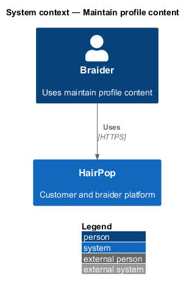
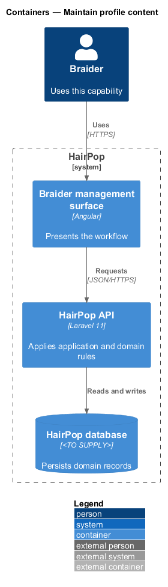
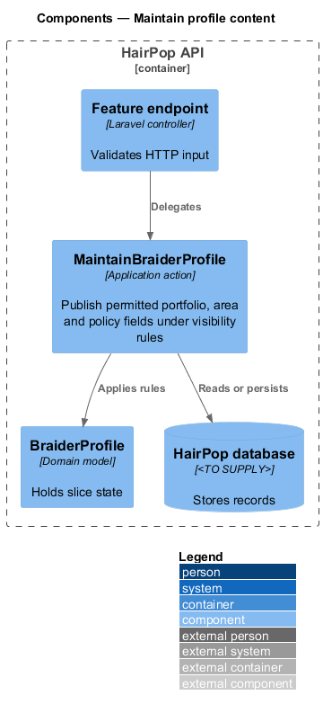
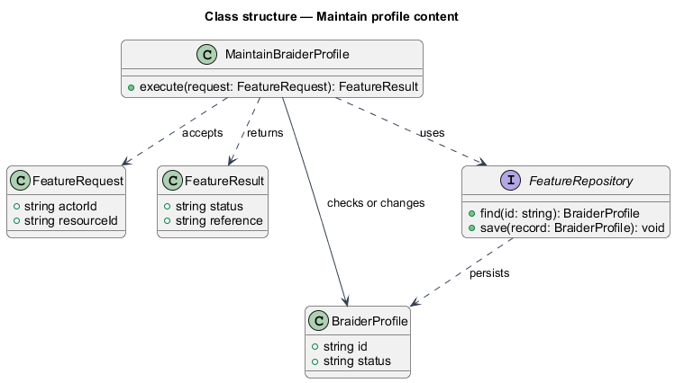
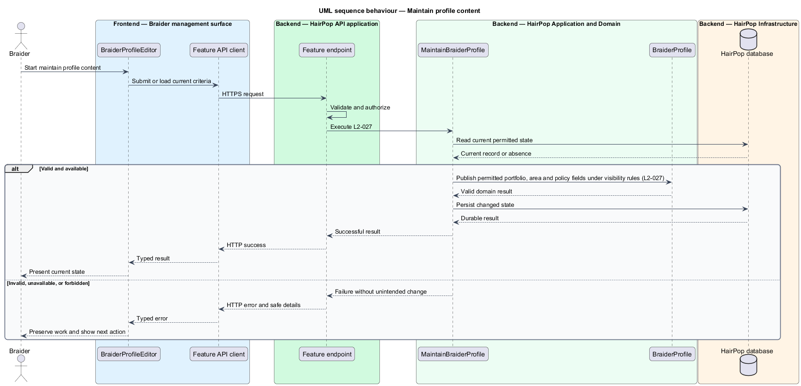

# Maintain profile content

## Overview

HairPop connects customers with braiders through published styles, service offerings, and appointment workflows. The offerings subsystem supports this braider workflow. The `BraiderProfile` is the domain record that carries this slice's state. The slice addresses `L2-027`. Its central behavior is to publish permitted portfolio, area and policy fields under visibility rules.

## Description

`BraiderProfileEditor` is the proposed Angular screen or dialog for this slice. It reads a typed API contract through an injection token and presents the states represented in the mocks. `MaintainBraiderProfile` is the proposed Laravel application action. Its responsibility is to publish permitted portfolio, area and policy fields under visibility rules. The API route and request and response schema are <TO SUPPLY>. A thin Laravel controller validates the request and delegates to the action. The `BraiderProfile` model holds the persisted state relevant to the action. Ownership and publication checks run before private fields are returned or changed. The repository persists or reads records through Laravel data access.

## Requirements

| L2 ID | Refines (L1) | Requirement |
|-------|--------------|-------------|
| `L2-027` | `L1-008` | A braider must be able to maintain their own publishable portfolio material, service area, booking and cancellation terms, and preparation guidance; private contact or studio details must follow the visibility rules of the customer journey. |

## Diagrams

### System context

The braider uses HairPop for this capability. HairPop owns the state and publishes only the permitted result.

### Containers

The braider management surface calls the Laravel API. The API reads or changes the HairPop database.

### Components

The API endpoint delegates to `MaintainBraiderProfile`. The action applies the relevant rules around `BraiderProfile` and persistence.

### Class structure

`MaintainBraiderProfile` receives a typed request, uses `BraiderProfile`, and returns a typed result.

### Behaviour

The sequence applies `L2-027` while handling invalid or unavailable state without reporting success.

