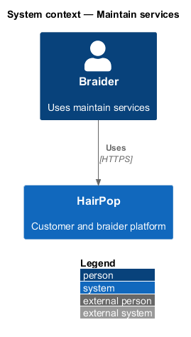
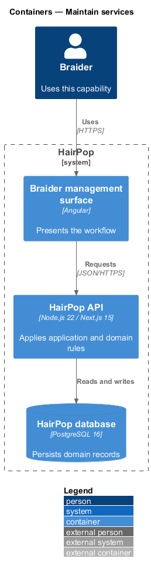
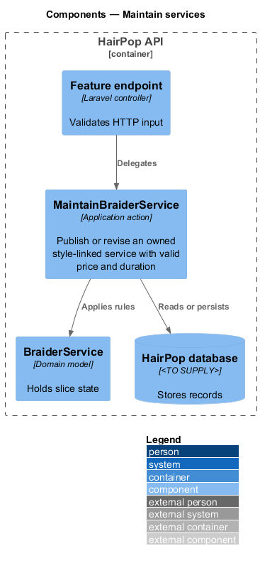
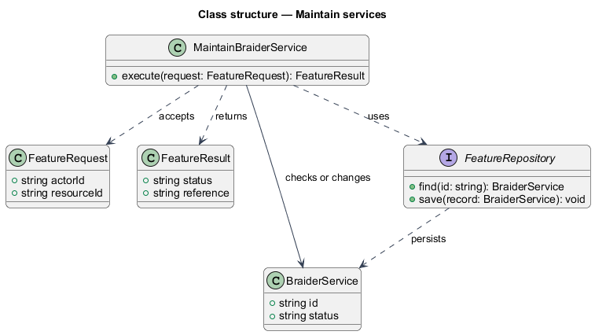
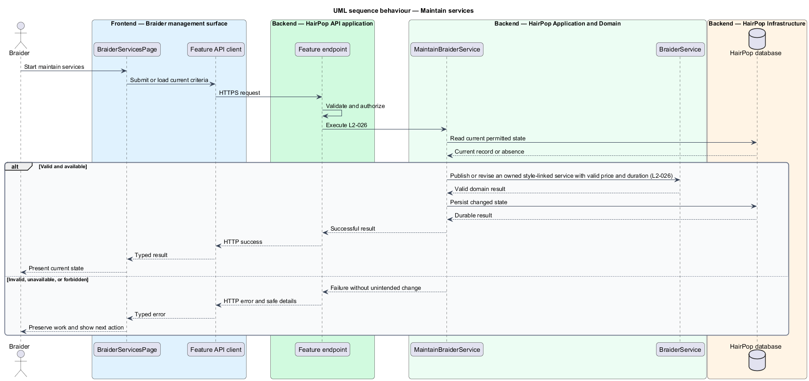

# Maintain services

## Overview

HairPop connects customers with braiders through published styles, service offerings, and appointment workflows. The offerings subsystem supports this braider workflow. The `BraiderService` is the domain record that carries this slice's state. The slice addresses `L2-026`. Its central behavior is to publish or revise an owned style-linked service with valid price and duration.

## Description

`BraiderServicesPage` is the proposed Angular screen or dialog for this slice. It reads a typed API contract through an injection token and presents the states represented in the mocks. `MaintainBraiderService` is the proposed application action in the Next.js API. Its responsibility is to publish or revise an owned style-linked service with valid price and duration. The API contract for this slice is listed below. A thin Next.js route handler validates the request and delegates to the action. The `BraiderService` model holds the persisted state relevant to the action. Ownership and publication checks run before private fields are returned or changed. The repository persists or reads records through Prisma.

**Frontend.** Publish and Unpublish send a `PATCH` with only `published` and `version`.

**Backend.** `MaintainBraiderServices` is braider-only (403 `not_braider` for a customer or a braider account without a profile) and acts on the braider's own services; another braider's service is 403, an unknown or removed one 404. `styleSlug` must name a published style; `startingPrice` is a whole-dollar amount from 0, `typicalHours` is more than 0 and at most 24, and a blank `preparation` is `null` (L2-026 AC2). Edits apply with a conditional update on `version`; an edit based on an older version is 409 `stale` and keeps the newer values (L2-047 AC4). A `PATCH` changes only the fields it sends. Remove is a soft delete (`removedAt`, unpublished), so past appointments and reviews still resolve while the service leaves the list, matching and booking (L2-026 AC3). Appointments snapshot the service name, duration and estimate at submission.

| Part | Value |
|------|-------|
| Application | braider |
| Route | `/manage/services` |
| Components | `BraiderServicesPage`, `EditServiceDialog`, `RemoveServiceDialog` |
| API token | `BRAIDER_SERVICES_API` (`BraiderServicesApi`) |
| Render mode | Browser (braider app) |
| Mocks | `pages/braider-services/*`, `dialogs/edit-service/*`, `dialogs/remove-service/*` |

**API contract.** All paths are relative to the API origin; JSON bodies; errors use `ApiErrorBody`.

| Method | Path | Access | Request | Success | Errors |
|--------|------|--------|---------|---------|--------|
| GET | `/api/braider/services` | braider | — | 200 `{ data: BraiderService[]; styles: { slug: string; name: string }[] }` | 401; 403 |
| POST | `/api/braider/services` | braider | `ServiceInput` | 201 `BraiderService` | 422 |
| PATCH | `/api/braider/services/{id}` | braider (owner) | `ServiceInput & { version }` | 200 `BraiderService` | 403; 409 `stale`; 422 |
| DELETE | `/api/braider/services/{id}` | braider (owner) | — | 204 | 403 |

```ts
interface ServiceInput { styleSlug: string; name: string; startingPrice: number; typicalHours: number; preparation: string | null; published: boolean }
interface BraiderService extends ServiceInput { id: string; styleName: string; version: number }
```

## Requirements

| L2 ID | Refines (L1) | Requirement |
|-------|--------------|-------------|
| `L2-026` | `L1-008` | An authenticated braider must be able to add, revise, unpublish, and remove their own style-linked offerings, including a starting price or range, typical duration, and service-specific preparation details. |
| `L2-047` | `L1-015` | Each braider management screen and dialog must implement the states listed for it in the mock manifest, edit through dialogs or dedicated screens rather than inline page forms, and report conflicts without overwriting newer data. |

## Diagrams

### System context

The braider uses HairPop for this capability. HairPop owns the state and publishes only the permitted result.



### Containers

The braider management surface calls the Next.js API. The API reads or changes the HairPop database.



### Components

The API endpoint delegates to `MaintainBraiderService`. The action applies the relevant rules around `BraiderService` and persistence.



### Class structure

`MaintainBraiderService` receives a typed request, uses `BraiderService`, and returns a typed result.



### Behaviour

The sequence applies `L2-026` while handling invalid or unavailable state without reporting success.


