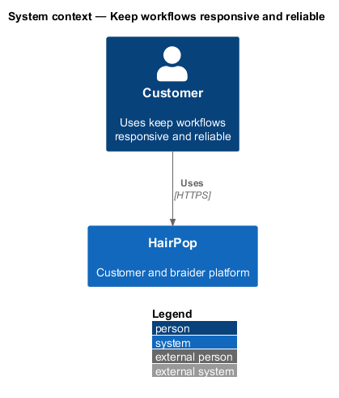
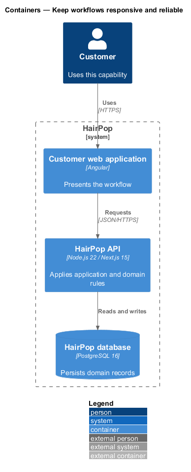
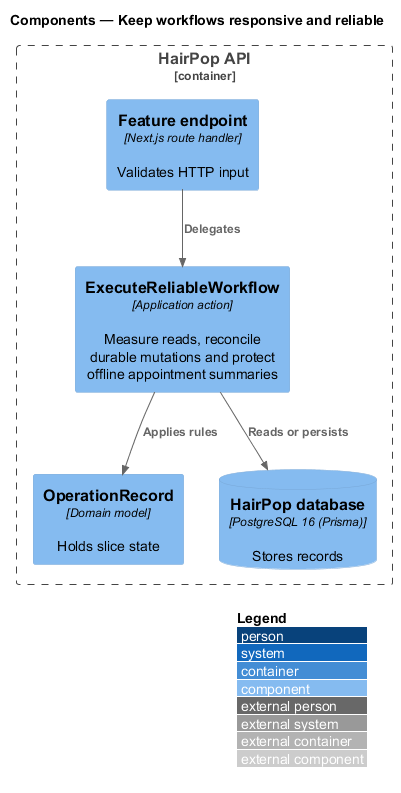
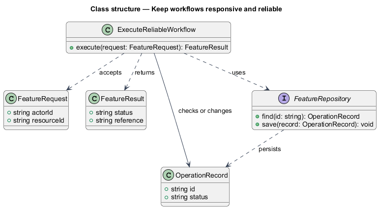
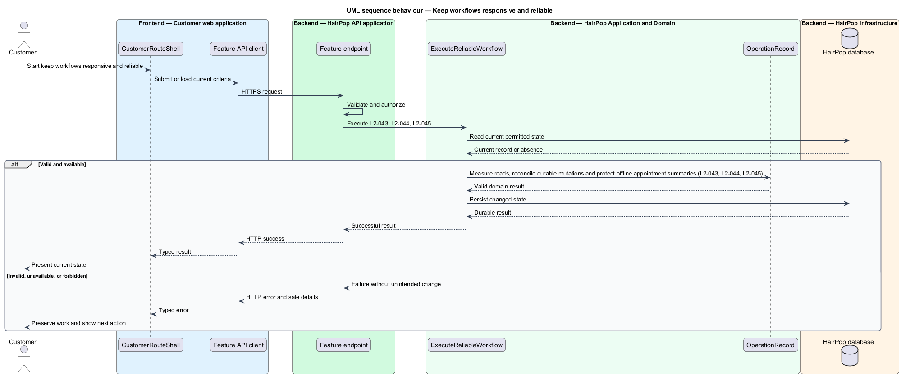

# Keep workflows responsive and reliable

## Overview

HairPop connects customers with braiders through published styles, service offerings, and appointment workflows. The operations subsystem supports this customer workflow. The `OperationRecord` is the domain record that carries this slice's state. The slice addresses `L2-043`, `L2-044`, `L2-045`. Its central behavior is to measure reads, reconcile durable mutations and protect offline appointment summaries.

## Description

`CustomerRouteShell` is the proposed Angular screen or dialog for this slice. It reads a typed API contract through an injection token and presents the states represented in the mocks. `ExecuteReliableWorkflow` is the proposed Laravel application action. Its responsibility is to measure reads, reconcile durable mutations and protect offline appointment summaries. The API contract for this slice is listed below. A thin Laravel controller validates the request and delegates to the action. The `OperationRecord` model holds the persisted state relevant to the action. Ownership and publication checks run before private fields are returned or changed. The repository persists or reads records through Laravel data access.

**Frontend.** On the server, `API_ORIGIN` prefixes relative `/api` URLs and the incoming `Cookie` header is forwarded; in the browser the API is same-origin (ADR 0002). Offline is detected from `navigator.onLine` and failed requests.

| Part | Value |
|------|-------|
| Application | customer and braider |
| Route | every route |
| Components | `apiOriginInterceptor`, `idempotencyKey()`, `OfflineStatus` |
| API token | `API_ORIGIN` |
| Render mode | both |
| Mocks | `pages/*/offline`, `pages/server-error/*` |

**API contract.** All paths are relative to the API origin; JSON bodies; errors use `ApiErrorBody`.

| Method | Path | Access | Request | Success | Errors |
|--------|------|--------|---------|---------|--------|
| — | every mutation that creates a record sends `Idempotency-Key`; every response carries `X-Correlation-Id` | — | — | — | — |

## Requirements

| L2 ID | Refines (L1) | Requirement |
|-------|--------------|-------------|
| `L2-043` | `L1-014` | Core discovery and owned-data reads must have measurable latency targets under the project's agreed reference load, without omitting loading and failure feedback. |
| `L2-044` | `L1-014` | State-changing actions must produce an unambiguous durable outcome, tolerate safe retries, and emit diagnosable request and failure records without private content or secrets. |
| `L2-045` | `L1-014` | Previously available appointment summaries may remain readable offline for the current customer, while new requests and mutations must wait for a connection; locally held customer data must be removed at sign-out. |

## Diagrams

### System context

The customer uses HairPop for this capability. HairPop owns the state and publishes only the permitted result.

### Containers

The customer web application calls the Laravel API. The API reads or changes the HairPop database.

### Components

The API endpoint delegates to `ExecuteReliableWorkflow`. The action applies the relevant rules around `OperationRecord` and persistence.

### Class structure

`ExecuteReliableWorkflow` receives a typed request, uses `OperationRecord`, and returns a typed result.

### Behaviour

The sequence applies `L2-043`, `L2-044`, `L2-045` while handling invalid or unavailable state without reporting success.

