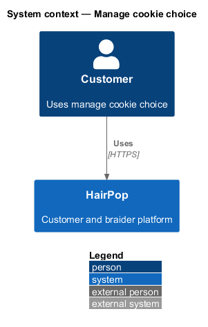
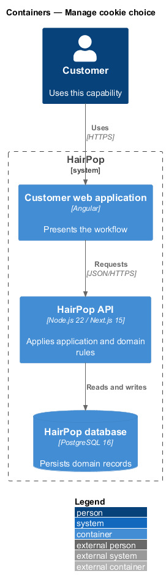
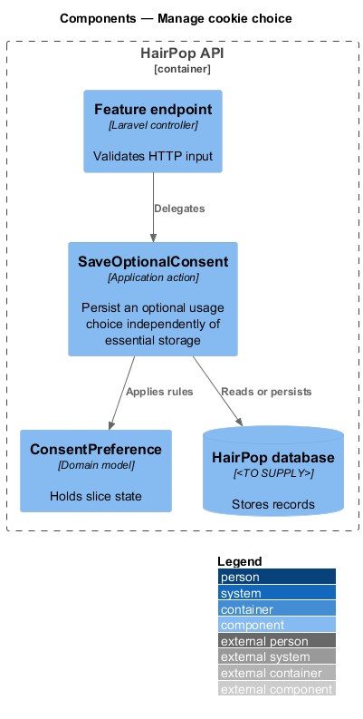
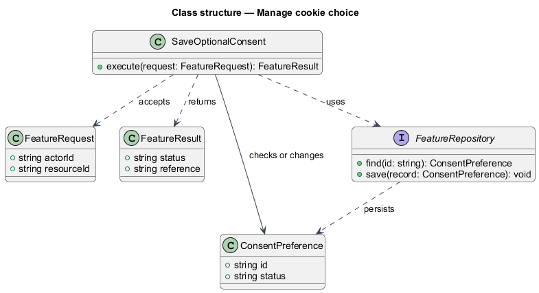
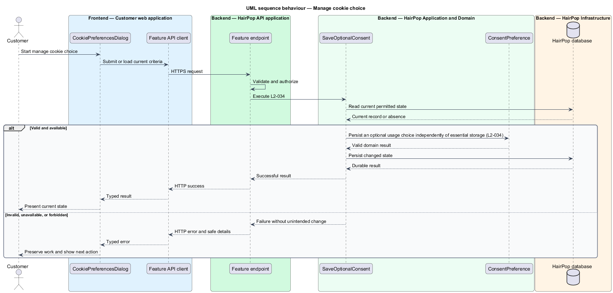

# Manage cookie choice

## Overview

HairPop connects customers with braiders through published styles, service offerings, and appointment workflows. The privacy subsystem supports this customer workflow. The `ConsentPreference` is the domain record that carries this slice's state. The slice addresses `L2-034`. Its central behavior is to persist an optional usage choice independently of essential storage.

## Description

`CookiePreferencesDialog` is the proposed Angular screen or dialog for this slice. It reads a typed API contract through an injection token and presents the states represented in the mocks. `SaveOptionalConsent` is the proposed Laravel application action. Its responsibility is to persist an optional usage choice independently of essential storage. The API contract for this slice is listed below. A thin Laravel controller validates the request and delegates to the action. The `ConsentPreference` model holds the persisted state relevant to the action. Ownership and publication checks run before private fields are returned or changed. The repository persists or reads records through Laravel data access.

**Frontend.** The saved choice is also written to the essential cookie `hp-consent` after a successful save, so the banner stays away on return (L2-034 AC2). Nothing optional is stored before a choice (L2-034 AC1).

| Part | Value |
|------|-------|
| Application | customer |
| Route | banner on every page; dialog from the banner and footer |
| Components | `CookieBanner`, `CookiePreferencesDialog`, `ConsentStore` |
| API token | `CONSENT_API` (`ConsentApi`) |
| Render mode | Browser |
| Mocks | `dialogs/cookie-preferences/*`, `notifications/cookie-consent/*` |

**API contract.** All paths are relative to the API origin; JSON bodies; errors use `ApiErrorBody`.

| Method | Path | Access | Request | Success | Errors |
|--------|------|--------|---------|---------|--------|
| PUT | `/api/consent` | public | `{ optionalUsage: boolean }` | 200 `{ optionalUsage: boolean; savedAt: IsoDateTime }` | 422; 5xx |

## Requirements

| L2 ID | Refines (L1) | Requirement |
|-------|--------------|-------------|
| `L2-034` | `L1-010` | Visitors must be able to accept or decline optional usage storage independently of essential storage, revise the choice later, and receive accurate save feedback. |

## Diagrams

### System context

The customer uses HairPop for this capability. HairPop owns the state and publishes only the permitted result.

### Containers

The customer web application calls the Laravel API. The API reads or changes the HairPop database.

### Components

The API endpoint delegates to `SaveOptionalConsent`. The action applies the relevant rules around `ConsentPreference` and persistence.

### Class structure

`SaveOptionalConsent` receives a typed request, uses `ConsentPreference`, and returns a typed result.

### Behaviour

The sequence applies `L2-034` while handling invalid or unavailable state without reporting success.

