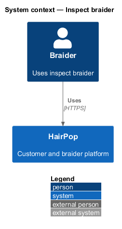
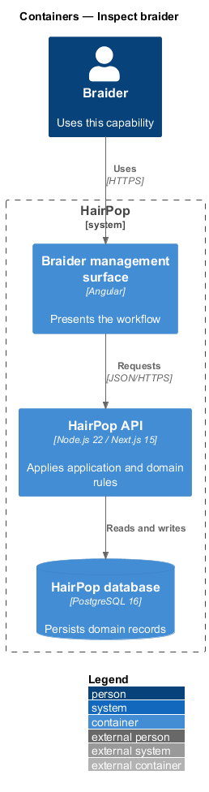
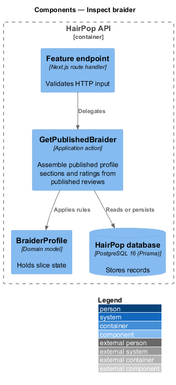
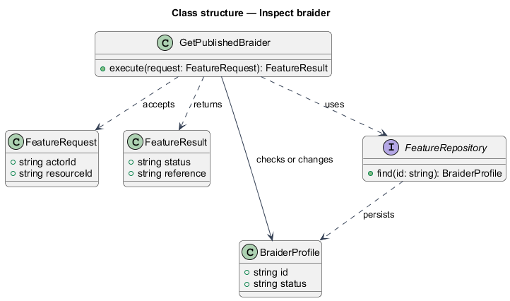
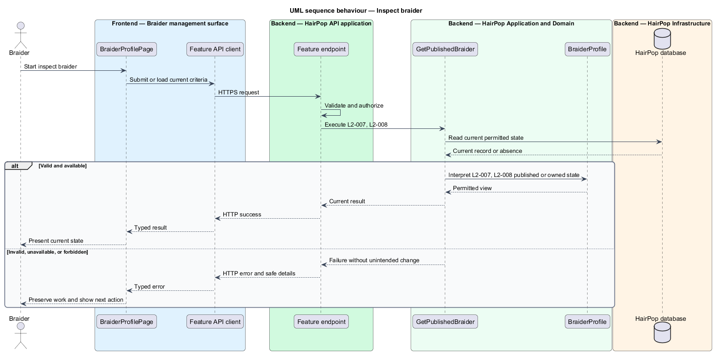

# Inspect braider

## Overview

HairPop connects customers with braiders through published styles, service offerings, and appointment workflows. The profiles subsystem supports this braider workflow. The `BraiderProfile` is the domain record that carries this slice's state. The slice addresses `L2-007`, `L2-008`. Its central behavior is to assemble published profile sections and ratings from published reviews.

## Description

`BraiderProfilePage` is the proposed Angular screen or dialog for this slice. It reads a typed API contract through an injection token and presents the states represented in the mocks. `GetPublishedBraider` is the proposed application action in the Next.js API. Its responsibility is to assemble published profile sections and ratings from published reviews. The API contract for this slice is listed below. A thin Next.js route handler validates the request and delegates to the action. The `BraiderProfile` model holds the persisted state relevant to the action. Ownership and publication checks run before private fields are returned or changed. The repository persists or reads records through Prisma.

**Frontend.** The private studio address is never part of the public profile (L2-027 AC3). The booking action links to `/book/:slug` with the braider's slug (L2-007 AC1).

| Part | Value |
|------|-------|
| Application | customer |
| Route | `/braiders/:slug` |
| Components | `BraiderProfilePage` |
| API token | `BRAIDERS_API` (`BraidersApi`) |
| Render mode | Server; reviews load in the browser so their failure is partial |
| Mocks | `pages/braider-profile/*` |

**API contract.** All paths are relative to the API origin; JSON bodies; errors use `ApiErrorBody`.

| Method | Path | Access | Request | Success | Errors |
|--------|------|--------|---------|---------|--------|
| GET | `/api/braiders/{slug}` | public | — | 200 `BraiderProfile` | 404 unknown or unpublished |
| GET | `/api/braiders/{slug}/reviews?page` | public | query: `page` | 200 `Page<Review>` | 404 |

```ts
interface BraiderProfile {
  slug: string; name: string; initials: string; photo: Image | null; area: string; travelKm: number | null; bio: string;
  rating: { average: number; count: number } | null;
  services: { id: string; name: string; styleSlug: string; startingPrice: number; typicalHours: number }[];
  portfolio: { id: string; image: Image | null; caption: string }[];
  policies: { preparation: string | null; changes: string | null; cancellation: string | null };
}
interface Review { id: string; rating: number; date: string /* YYYY-MM-DD */; text: string; author: string; service: string }
```

## Requirements

| L2 ID | Refines (L1) | Requirement |
|-------|--------------|-------------|
| `L2-007` | `L1-003` | A public braider profile must show the braider's published identity, services, relevant portfolio, review summary and published reviews, service area, preparation guidance, policies, and a booking route where a request can be made. |
| `L2-008` | `L1-003` | Rating and review counts must derive from published reviews for the braider and must not include removed or pending-moderation reviews. |

## Diagrams

### System context

The braider uses HairPop for this capability. HairPop owns the state and publishes only the permitted result.



### Containers

The braider management surface calls the Next.js API. The API reads or changes the HairPop database.



### Components

The API endpoint delegates to `GetPublishedBraider`. The action applies the relevant rules around `BraiderProfile` and persistence.



### Class structure

`GetPublishedBraider` receives a typed request, uses `BraiderProfile`, and returns a typed result.



### Behaviour

The sequence applies `L2-007`, `L2-008` while handling invalid or unavailable state without reporting success.


