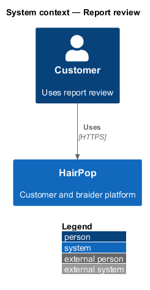
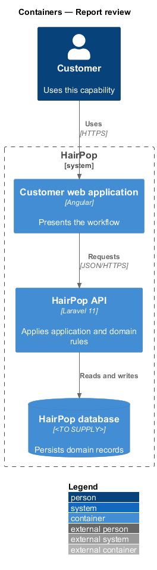
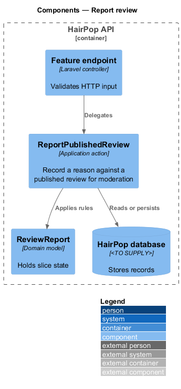
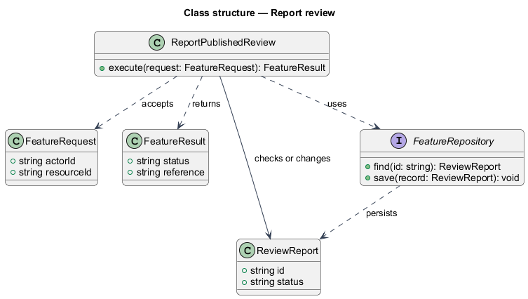
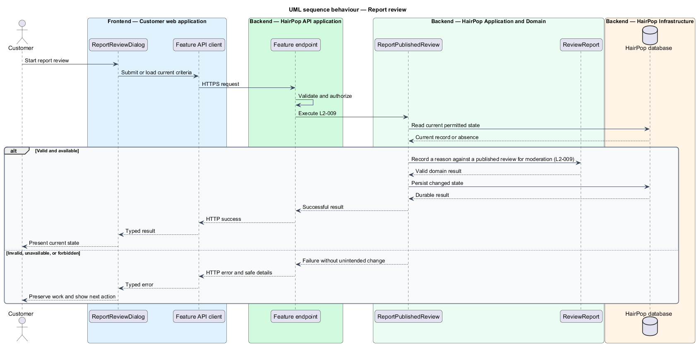

# Report review

## Overview

HairPop connects customers with braiders through published styles, service offerings, and appointment workflows. The profiles subsystem supports this customer workflow. The `ReviewReport` is the domain record that carries this slice's state. The slice addresses `L2-009`. Its central behavior is to record a reason against a published review for moderation.

## Description

`ReportReviewDialog` is the proposed Angular screen or dialog for this slice. It reads a typed API contract through an injection token and presents the states represented in the mocks. `ReportPublishedReview` is the proposed application action in the Next.js API. Its responsibility is to record a reason against a published review for moderation. The API contract for this slice is listed below. A thin Next.js route handler validates the request and delegates to the action. The `ReviewReport` model holds the persisted state relevant to the action. Ownership and publication checks run before private fields are returned or changed. The repository persists or reads records through Prisma.

**Frontend.** A signed-out visitor who chooses Report review is sent to `/sign-in?returnUrl=…` before the dialog opens (L2-009 AC4).

**Backend.** `ReportPublishedReview` records an `open` `ReviewReport` for a published review of a published braider and leaves the review untouched (L2-009 AC1). One report per customer per review: a repeat — or a concurrent duplicate — answers 201 with the first `reportId`. A customer may file ten new reports an hour (L2-040 AC2). Blank `details` are stored as `null`; details over 1,000 characters answer 422 `errors.details`. The endpoint is customer-only (403 `not_customer` for a braider).

| Part | Value |
|------|-------|
| Application | customer |
| Route | dialog over `/braiders/:slug` |
| Components | `ReportReviewDialog` |
| API token | `BRAIDERS_API` (`BraidersApi.reportReview`) |
| Render mode | Browser |
| Mocks | `dialogs/report-review/*` |

**API contract.** All paths are relative to the API origin; JSON bodies; errors use `ApiErrorBody`.

| Method | Path | Access | Request | Success | Errors |
|--------|------|--------|---------|---------|--------|
| POST | `/api/reviews/{id}/reports` | customer | `{ reason: 'not_real_visit' \| 'offensive' \| 'private_info' \| 'other'; details: string \| null }` | 201 `{ reportId: string }` | 401 signed out; 404; 422 `errors.reason`; 429 `retryAfter` |

## Requirements

| L2 ID | Refines (L1) | Requirement |
|-------|--------------|-------------|
| `L2-009` | `L1-003` | An authenticated customer must be able to report a published review with a reason. Reports must enter a moderation workflow without immediately changing the public review. |

## Diagrams

### System context

The customer uses HairPop for this capability. HairPop owns the state and publishes only the permitted result.

### Containers

The customer web application calls the Next.js API. The API reads or changes the HairPop database.

### Components

The API endpoint delegates to `ReportPublishedReview`. The action applies the relevant rules around `ReviewReport` and persistence.

### Class structure

`ReportPublishedReview` receives a typed request, uses `ReviewReport`, and returns a typed result.

### Behaviour

The sequence applies `L2-009` while handling invalid or unavailable state without reporting success.

