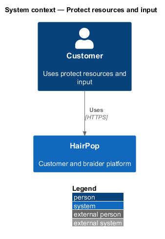
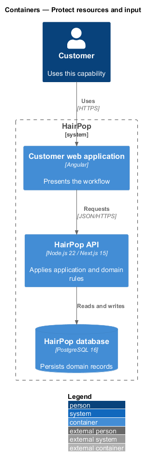
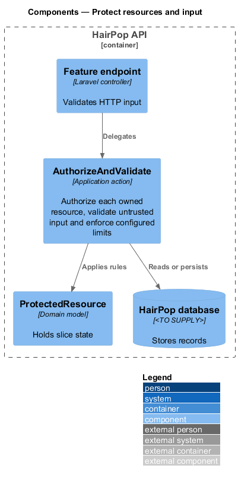
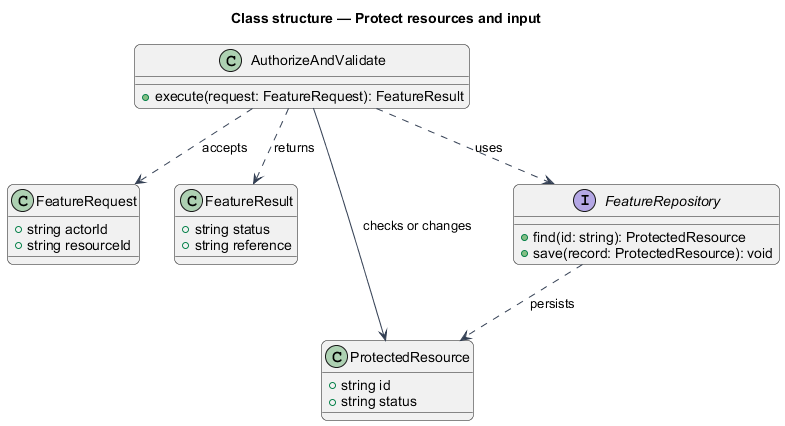
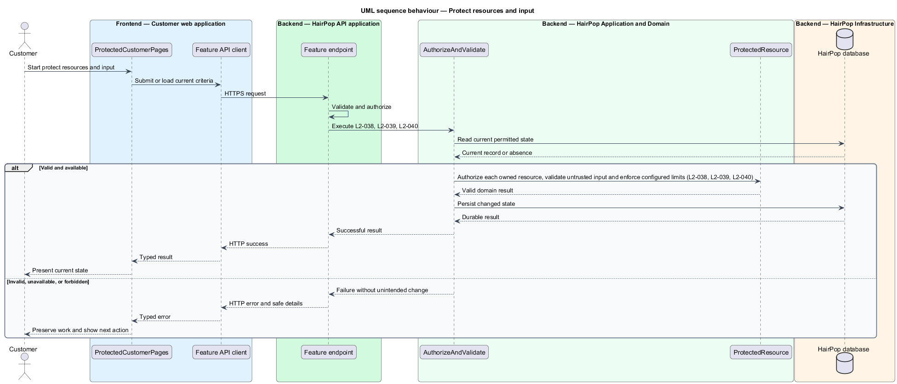

# Protect resources and input

## Overview

HairPop connects customers with braiders through published styles, service offerings, and appointment workflows. The security subsystem supports this customer workflow. The `ProtectedResource` is the domain record that carries this slice's state. The slice addresses `L2-038`, `L2-039`, `L2-040`. Its central behavior is to authorize each owned resource, validate untrusted input and enforce configured limits.

## Description

`ProtectedCustomerPages` is the proposed Angular screen or dialog for this slice. It reads a typed API contract through an injection token and presents the states represented in the mocks. `AuthorizeAndValidate` is the proposed Laravel application action. Its responsibility is to authorize each owned resource, validate untrusted input and enforce configured limits. The API contract for this slice is listed below. A thin Laravel controller validates the request and delegates to the action. The `ProtectedResource` model holds the persisted state relevant to the action. Ownership and publication checks run before private fields are returned or changed. The repository persists or reads records through Laravel data access.

**Frontend.** User text renders through Angular interpolation only; no `innerHTML` binds user content (L2-039 AC2).

| Part | Value |
|------|-------|
| Application | customer and braider |
| Route | protected routes |
| Components | `authGuard`, `braiderGuard`, `ProtectedCustomerPages` |
| API token | `AUTH_API` |
| Render mode | Browser for protected routes (`RenderMode.Client`) |
| Mocks | `pages/forbidden/*`, `pages/sign-in/*` |

**API contract.** All paths are relative to the API origin; JSON bodies; errors use `ApiErrorBody`.

| Method | Path | Access | Request | Success | Errors |
|--------|------|--------|---------|---------|--------|
| — | every `/api/appointments*`, `/api/account`, `/api/notifications*`, `/api/booking-requests`, `/api/braider/*` endpoint requires a session; discovery, braider profiles and content are public | — | — | — | 401 / 403 / 404 without private fields |

## Requirements

| L2 ID | Refines (L1) | Requirement |
|-------|--------------|-------------|
| `L2-038` | `L1-012` | Customer-owned and braider-owned API resources and actions must require authentication and enforce ownership or assigned-braider authorization; published discovery, Help, Terms, and Privacy remain intentionally public. |
| `L2-039` | `L1-012` | The API must validate submitted fields and media; rendered user content must not execute code; private contact, reset, verification, and appointment data must be protected in storage and transit. |
| `L2-040` | `L1-012` | Account, password recovery, verification resend, review reporting, and booking submission must have server-side abuse controls that preserve a usable recovery path. |

## Diagrams

### System context

The customer uses HairPop for this capability. HairPop owns the state and publishes only the permitted result.

### Containers

The customer web application calls the Laravel API. The API reads or changes the HairPop database.

### Components

The API endpoint delegates to `AuthorizeAndValidate`. The action applies the relevant rules around `ProtectedResource` and persistence.

### Class structure

`AuthorizeAndValidate` receives a typed request, uses `ProtectedResource`, and returns a typed result.

### Behaviour

The sequence applies `L2-038`, `L2-039`, `L2-040` while handling invalid or unavailable state without reporting success.

